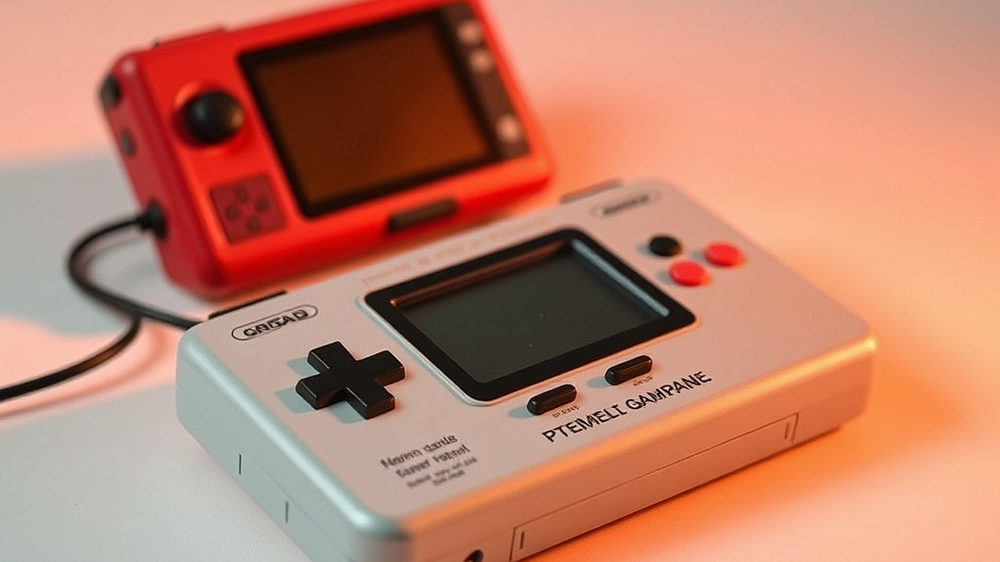

# 어른의 레트로, 90년대 게임기 복각판이 주는 향수와 현실적 한계

레트로 게임기 복각판은 우리 세대에게 일종의 타임머신과 같습니다. 90년대, 학교가 끝나면 친구 집 안방에 모여 앉아 브라운관 TV 앞에 옹기종기 모여 앉았던 그 시절의 공기를 되찾고 싶어 하는 마음이죠. 20대 후반부터 40대까지, 우리에게 게임은 단순한 놀이가 아니라 척박했던 학창 시절을 버티게 해준 가장 강력한 도피처였습니다. 하지만 막상 성인이 되어 다시 마주한 복각판 게임기는 우리에게 낯선 숙제를 던집니다. 30년 전의 그 찬란했던 그래픽과 조작감이 4K 디스플레이와 고성능 PC 게임에 익숙해진 지금의 눈높이와 정면으로 충돌하기 때문입니다. 많은 이들이 지갑을 열어 구매 버튼을 누르지만, 정작 책상 한구석에 먼지만 쌓여가는 기기를 보며 씁쓸함을 느끼는 이유이기도 합니다. 오늘은 단순히 추억에 기대어 소비하는 것이 아니라, 지금 우리에게 이 복각 게임기가 어떤 가치를 주는지, 그리고 과연 내 공간과 시간에 들일만한 가치가 있는지를 냉정하게 따져보려 합니다.

## 내 책상 위 작은 추억, 구매 전 반드시 따져야 할 것

복각판 게임기를 구매하기 전 가장 먼저 고려해야 할 것은 '공간 점유'와 '연결 방식'입니다. 많은 분이 디자인만 보고 덜컥 구매했다가, 실제 세팅 과정에서 당혹감을 느낍니다. 요즘 나오는 복각판들은 대부분 HDMI를 지원하지만, 90년대 게임 특유의 도트 그래픽을 현대의 대형 LED TV에 그대로 띄우면 화면이 지나치게 늘어지거나 깨져 보이는 현상이 발생합니다. 

실제 사례를 들어보겠습니다. 30대 후반 직장인 A씨는 어린 시절 즐겼던 횡스크롤 액션 게임을 다시 하기 위해 복각판을 구매했습니다. 하지만 65인치 TV에 연결하자마자 화면이 너무 거칠게 표현되어 실망했습니다. 결국 그는 게임기를 중고 장터에 내놓았습니다. 반면, 20대 중반 B씨는 책상 위 24인치 모니터에 연결해 '레트로 감성'을 인테리어 소품으로 활용하며 가끔 짧게 즐기는 방식으로 만족감을 찾았습니다.

실패 케이스의 핵심은 '기대치의 오류'입니다. 옛날 게임의 픽셀 아트는 당시의 낮은 해상도와 브라운관의 번짐 효과가 합쳐져 완성된 결과물입니다. 이를 현대의 선명한 디스플레이로 보면 의도치 않게 거친 파편처럼 보이게 됩니다. 따라서 구매 전, 본인이 가진 디스플레이 환경과 기기가 제공하는 화면 보정 옵션(스캔라인 모드 등)이 있는지 반드시 확인해야 합니다.

선택 기준은 명확합니다. 퇴근 후 30분 내외로 가볍게 과거의 기억을 환기하고 싶은지, 아니면 엔딩까지 끈기 있게 플레이할 목적이 있는지 스스로 물어보세요. 후자라면 복각판보다는 차라리 범용적인 에뮬레이션 기기나 PC를 활용하는 것이 훨씬 효율적일 수 있습니다. 복각판은 '완성된 소장품'이지, '고성능 게임기'가 아님을 인지하는 것이 핵심입니다.

## 실전 체크리스트: 당신에게 맞는 기기인가?

레트로 게임기 구매를 고민할 때, 흔히 저지르는 실수는 '모든 게임이 다 들어있을 것'이라는 막연한 기대입니다. 복각판 기기들은 저작권 문제로 인해 수록된 게임의 리스트가 엄격하게 제한되어 있습니다. 내가 그토록 하고 싶었던 특정 게임이 빠져 있다면, 그 기기는 사실상 절반의 가치도 잃게 됩니다.

다음은 구매 결정 전 반드시 체크해야 할 실전 체크리스트입니다.

1. 수록 게임 리스트 확인: 제조사 홈페이지에 공개된 리스트를 보고, 최소 3개 이상의 '인생 게임'이 포함되어 있는지 확인하십시오. 단순히 '유명한 게임'이 많은 것이 중요한 게 아닙니다.
2. 조작감의 이질성: 복각판은 원본 게임기의 컨트롤러를 재현하지만, 세월이 흐르며 우리의 손 크기와 반응 속도는 변했습니다. 유선 컨트롤러라면 케이블 길이는 충분한지, 무선이라면 입력 지연(인풋렉)은 없는지 리뷰를 통해 확인해야 합니다.
3. 세이브 기능의 유무: 90년대 게임은 원래 난이도가 높고 세이브 포인트가 불친절했습니다. 복각판에 '중단 저장' 기능이 포함되어 있지 않다면, 현대인의 바쁜 일상에서 끝까지 플레이하기는 사실상 불가능합니다.
4. 확장성: USB 포트를 통해 추가 컨트롤러를 연결할 수 있는지, 혹은 소프트웨어 업데이트가 지원되는지 확인하세요. 이는 기기 수명과 직결됩니다.

만약 이 리스트 중 2개 이상이 불만족스럽다면 구매를 재고해야 합니다. 특히 난이도 문제로 인해 초반부만 반복하다가 흥미를 잃는 경우가 가장 흔한 실패 패턴입니다. 게임기는 장식품이 아니라 플레이 도구입니다. 나의 라이프스타일이 90년대의 '지루함도 견디던 시절'로 돌아갈 수 있는지, 혹은 현대적인 편의 기능을 갖춘 기기를 선호하는지 판단하는 것이 우선입니다.

## 왜 지금 다시 레트로인가, 소비의 본질에 관하여

사람들이 복각 게임기에 반응하는 이유는 단순히 '옛날 것이 좋아서'가 아닙니다. 지금의 게임들은 너무나 복잡하고 방대합니다. 매일 업데이트를 확인해야 하고, 다른 사람들과 경쟁해야 하며, 엄청난 양의 텍스트와 튜토리얼을 숙지해야 합니다. 이에 비해 90년대 게임은 '시작 버튼을 누르면 바로 게임이 시작된다'는 아주 단순하고 명쾌한 규칙을 가지고 있습니다.

이러한 '즉각적인 즐거움'은 현대인에게 큰 위안이 됩니다. 하지만 여기서 발생하는 현실적 한계는 '콘텐츠의 고갈'입니다. 추억 속의 게임은 10시간이면 끝나는 경우가 많습니다. 복각판 기기를 구매하고 일주일이 지나면, 우리는 다시 '이제 뭘 하지?'라는 질문에 직면하게 됩니다. 

이때 중요한 것이 바로 '커뮤니티'와 '공유'입니다. 혼자서 추억에 잠기는 것은 금방 휘발됩니다. 대신, 내가 즐긴 게임의 스크린샷을 찍어 SNS에 공유하거나, 당시 함께 게임을 했던 친구들과 대화의 소재로 삼는 등 '현재의 관계'로 확장해야 합니다. 추억을 박제하는 것이 아니라, 추억을 매개로 현재의 나와 주변을 연결하는 도구로 사용할 때 비로소 레트로 게임기는 제값을 하게 됩니다.

실패하는 사람들은 기기 자체에 집착합니다. 성공하는 사람들은 그 기기를 통해 만들어지는 '경험의 시간'에 집중합니다. 만약 당신이 레트로 게임기를 구매한다면, 그것을 단순히 모니터 옆에 두는 오브제로 보지 마세요. 주말 저녁, 맥주 한 캔을 곁들여 과거의 나에게 안부를 묻는 의식의 도구로 활용해 보세요. 

## 결론: 추억은 짧고, 취향은 길게 가져가는 법

레트로 게임기 복각판은 우리에게 90년대의 감성을 배달해주지만, 그 안에는 30년이라는 시간의 간극이 분명히 존재합니다. 기기를 구매하기 전, 본인이 가진 공간의 여유와 게임을 즐길 수 있는 현실적인 시간, 그리고 무엇보다 '추억 보정'을 걷어낸 상태에서도 그 게임이 재미있을지 스스로 냉정하게 평가해야 합니다.

결국, 복각판 게임기의 가치는 '완벽한 게임 경험'이 아니라 '그 시절의 나를 기억해내는 매개체'라는 점에 있습니다. 기기 성능이 조금 부족하거나 그래픽이 투박해도, 그 기기 앞에 앉아 있는 동안만큼은 스마트폰 알림을 끄고 온전히 나만의 시간에 집중할 수 있다면 그것으로 충분합니다. 

지금 당장 구매 버튼을 누르기보다는, 당신이 가장 좋아했던 게임 3가지를 먼저 떠올려 보십시오. 만약 그 게임들을 다시 플레이하는 상상만으로도 퇴근길이 조금 더 즐거워진다면, 그때는 기기를 구매해도 좋습니다. 하지만 단순히 멋져 보인다는 이유라면, 그 예산을 차라리 좋아하는 게임의 사운드트랙을 구매하거나, 옛 친구와 함께하는 저녁 식사에 투자하는 것이 훨씬 더 가치 있는 레트로 소비가 될 것입니다. 기억은 박제하는 것이 아니라, 현재의 삶 속에서 계속해서 재해석될 때 비로소 아름답습니다.

90년대 게임기 복각판은 단순히 과거의 기기를 재현하는 것을 넘어, 바쁜 일상 속에서 잠시 잊고 지냈던 어린 시절의 순수한 즐거움을 되찾아주는 특별한 매개체입니다. 하지만 기술적 완성도나 현실적인 만족감을 고려할 때, 무작정 구매하기보다는 자신의 추억과 현재의 라이프스타일을 먼저 차분히 따져보는 지혜가 필요합니다. 

이제 여러분의 기억 속에 남아 있는 소중한 게임들을 떠올려 보세요. 그 게임을 다시 마주할 때 가슴이 설렌다면 망설이지 말고 그 시절의 나를 만나러 가보시길 바랍니다. 만약 구매가 고민된다면, 잠시 시간을 내어 옛 친구와 함께 그때 그 시절의 이야기를 나누며 맛있는 저녁 식사를 즐겨보는 건 어떨까요? 어떤 방식이든 여러분의 소중한 추억이 오늘 하루를 더 다채롭고 따뜻하게 만들어 줄 것입니다. 오늘 밤, 여러분의 마음속에 남아 있는 가장 찬란했던 게임은 무엇인가요?
