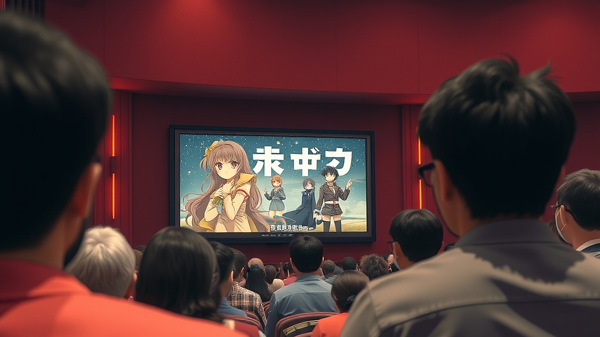

애니메이션 극장판의 흥행 공식은 이제 단순히 작품의 완성도만으로 결정되지 않으며, 팬덤 마케팅의 정교한 설계가 성인 관객들의 지갑을 여는 핵심 동력이 되었습니다. 과거 애니메이션 영화가 아이들을 위한 전유물로 여겨지던 시절은 지났습니다. 이제 극장가는 퇴근길에 홀로 영화관을 찾고, 좋아하는 캐릭터의 굿즈를 얻기 위해 기꺼이 N차 관람을 감행하는 3040 세대의 놀이터가 되었습니다. 

영화관 관객 수가 전반적으로 감소하는 추세 속에서도 특정 애니메이션만 예매율 상위권을 독차지하는 현상은 우연이 아닙니다. 이는 팬들이 가진 추억을 자극하는 서사와, 그 서사를 소유하고 싶어 하는 욕망을 정확히 타격한 결과입니다. 단순히 영화를 보는 행위에서 끝나는 것이 아니라, 극장에서만 얻을 수 있는 한정판 굿즈를 수집하고 이를 SNS에 인증하는 과정이 하나의 놀이 문화로 정착되었습니다. 오늘 이 글에서는 성인 관객들이 왜 특정 애니메이션 극장판에 열광하는지, 그리고 그들이 왜 영화관이라는 오프라인 공간으로 다시 발걸음을 옮기는지 그 마케팅적 기제를 낱낱이 파헤쳐 보겠습니다. 단순히 영화를 좋아하는 것을 넘어, 나만의 취향을 소비하고 팬덤의 일원으로서 만족감을 느끼고 싶은 분들이라면 이 글이 여러분의 다음 관람 계획에 실질적인 기준점이 될 것입니다.

## 팬덤 마케팅의 핵심: 소유하고 싶은 '경험'과 굿즈의 전략

성인 관객을 극장으로 불러들이는 가장 강력한 무기는 '희소성'입니다. 영화 자체는 OTT 플랫폼을 통해 언제든 다시 볼 수 있지만, 극장판 특전 굿즈는 오직 그 시간, 그 공간에서만 획득할 수 있습니다. 마케팅 담당자들은 이를 '관람의 보상'으로 치환합니다. 단순히 영화 티켓값을 지불하는 것이 아니라, 특정 굿즈를 얻기 위한 입장료를 지불한다는 심리를 유도하는 것입니다.

실제 사례를 들어보겠습니다. 과거 흥행한 스포츠 애니메이션 극장판의 경우, 관람객에게 선착순으로 증정하는 캐릭터 카드가 큰 화제를 모았습니다. 영화를 본 뒤 카드를 교환하거나, 원하는 캐릭터가 나올 때까지 여러 번 관람하는 'N차 관람' 열풍이 불었습니다. 이때 마케팅의 성공 기준은 단순히 관객 수에 있는 것이 아니라, 굿즈 소진 속도와 온라인 커뮤니티에서의 인증글 생성 빈도에 있습니다.

실패하는 케이스는 명확합니다. 팬들의 니즈를 파악하지 못한 굿즈를 배포할 때입니다. 예를 들어, 캐릭터의 매력을 전혀 담지 못한 단순한 로고 스티커나, 보관하기 불편한 대형 포스터는 오히려 관객들의 피로도만 높입니다. 팬들은 영화의 여운을 간직할 수 있는 '상징성' 있는 물건을 원합니다.

선택 기준은 이렇습니다. 여러분이 영화관을 선택할 때, 단순히 상영 시간만 보지 마세요. 배포되는 특전의 퀄리티가 내 소장 욕구를 자극하는지, 그리고 그 굿즈가 중고 거래 플랫폼에서 어느 정도의 가치를 유지하고 있는지(팬덤의 열기를 반증하는 지표)를 확인해야 합니다. 만약 굿즈가 매력적이지 않다면, 굳이 개봉 당일 조조를 고집할 이유가 없습니다.

## 실전 체크리스트: N차 관람을 결정하는 기준

N차 관람은 시간과 비용이 드는 일입니다. 따라서 무작정 반복해서 보는 것이 아니라, 자신의 소비 가치관에 따라 전략적으로 움직여야 합니다. 제가 영화를 두 번 이상 볼지 말지를 결정할 때 사용하는 체크리스트를 공유합니다.

1. 시각적 쾌감: 극장의 대형 스크린과 사운드 시스템이 아니면 감동이 반감되는 장면이 최소 3개 이상인가?
2. 소장 가치: 배포되는 특전 굿즈가 내 데스크테리어(Deskterior)나 수집함에 어울리는가?
3. 커뮤니티 참여도: 이 영화를 본 사람들과 감상을 나누고 싶은가, 아니면 혼자만의 기록으로 충분한가?

실수하기 쉬운 부분은 '남들이 다 하니까'라는 동조 심리에 휩쓸리는 것입니다. 특전 굿즈를 얻기 위해 무리하게 시간을 내어 영화를 보는 것은 취미 생활이 아닌 노동이 될 수 있습니다. 

반면, 성공적인 N차 관람은 영화의 새로운 디테일을 발견하는 기쁨을 줍니다. 첫 번째 관람에서는 줄거리를 따라가느라 놓쳤던 작화의 섬세함이나 배경음악의 변주를 두 번째 관람에서 발견할 때, 팬덤은 비로소 깊은 만족감을 느낍니다. 

이때의 측정 지표는 개인의 '만족도'입니다. 영화표 1만 5천 원을 지불하고 얻은 2시간의 몰입과 굿즈가 주는 심리적 안정감이 내가 평소 소비하는 카페 음료나 취미 용품의 가치와 비교했을 때 합리적인지를 따져보세요. 만약 이 비용이 부담스럽다면, 무리한 N차 관람 대신 영화관의 특별관(돌비 시네마, 아이맥스 등)을 한 번 제대로 즐기는 것이 훨씬 효율적인 선택입니다.

## 애니메이션 극장판 소비의 마케팅적 함정 피하기

기업들은 팬들의 '완결성'에 대한 욕구를 자극합니다. 캐릭터별로 굿즈를 나누어 배포하거나, 주차별로 다른 특전을 제공하는 방식이 대표적입니다. 이는 팬들에게는 수집의 재미를 주지만, 자칫하면 '굿즈를 위해 영화를 본다'는 주객전도 상황을 만듭니다.

여러분이 소비를 결정할 때 피해야 할 조건은 다음과 같습니다. 
- 영화의 평점이 지나치게 낮음에도 불구하고 굿즈의 희소성만 강조하는 경우
- 배포되는 특전이 지나치게 많아 소장 가치가 희석되는 경우
- 영화관의 위치가 너무 멀어 이동 비용이 티켓값을 상회하는 경우

처음 애니메이션 극장판을 즐기기 시작하는 분들이라면, 개봉 1주 차의 무리한 경쟁보다는 2주 차 이후의 여유로운 관람을 권합니다. 이때는 영화에 대한 입소문이 검증되어 있고, 굿즈 수급 상황도 파악할 수 있어 실패 확률이 낮아집니다.

마케팅의 입장에서 보면, 애니메이션 극장판은 '공동체적 경험'을 파는 상품입니다. 영화관은 더 이상 영상만 보는 곳이 아니라, 나와 같은 취향을 가진 사람들이 모여 있다는 사실을 확인하는 장소입니다. 이 흐름을 이해하고 소비한다면, 여러분은 단순한 관객을 넘어 자신의 취향을 능동적으로 관리하는 '프로슈머'가 될 수 있습니다.

결론적으로, 애니메이션 극장판 흥행 공식의 핵심은 팬덤의 '추억'과 '소유 욕구'를 마케팅으로 연결하는 데 있습니다. 무조건적인 N차 관람보다는 자신의 취향과 소장 가치를 명확히 판단하여 선택적으로 즐기는 태도가 필요합니다. 오늘 분석한 체크리스트를 활용해, 여러분의 다음 극장 나들이가 단순한 소비를 넘어 취향을 충전하는 시간이 되길 바랍니다. 굿즈는 거들 뿐, 가장 중요한 것은 그 작품을 통해 여러분이 얻는 개인적인 감동과 만족감임을 잊지 마세요. 지금 바로 상영 중인 작품들의 특전 정보를 확인하고, 나만의 관람 계획을 세워보는 건 어떨까요?

## 마치며

오늘 살펴본 것처럼, 애니메이션 극장판의 흥행은 단순히 작품의 힘만이 아니라 팬덤의 추억을 자극하고 소유의 즐거움을 극대화하는 마케팅 전략의 결실입니다. 이제 영화관은 단순히 영상을 소비하는 공간을 넘어, 같은 취향을 공유하는 이들이 모여 연대감을 확인하는 ‘취향의 공동체’가 되었습니다.

이러한 흐름 속에서 무조건적인 N차 관람이나 굿즈 수집에 매몰되기보다, 자신의 취향을 명확히 파악하고 가치 있는 소비를 즐기는 ‘똑똑한 프로슈머’가 되어보는 건 어떨까요? 본인이 진정으로 감동을 느낄 수 있는 작품을 선택하고, 그 과정을 통해 일상의 에너지를 충전하는 것이야말로 가장 현명한 덕질일 것입니다.

지금 바로 극장가 라인업을 살펴보고, 여러분의 마음을 설레게 할 작품을 골라보세요. 굿즈라는 특별한 선물도 좋지만, 영화가 끝난 뒤 마음속에 남을 진한 여운이야말로 여러분이 가져갈 가장 소중한 전리품이 될 테니까요. 이번 주말, 좋아하는 작품과 함께 나만의 소중한 시간을 기록하러 극장으로 떠나보시는 건 어떨까요?
