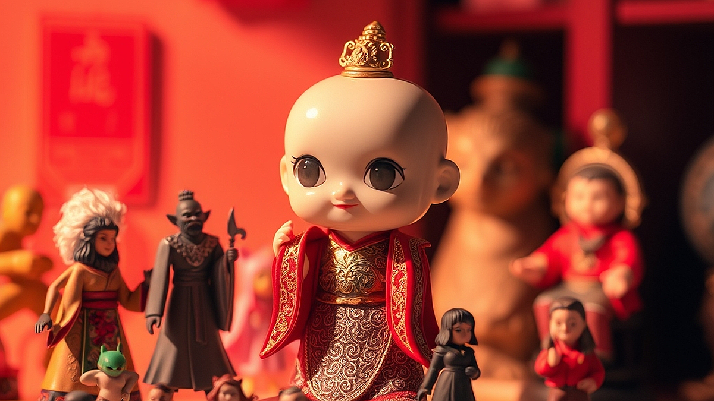

아트토이 수집의 명과 암이라는 주제는 단순히 귀여운 피규어를 책상 위에 올리는 행위를 넘어, 이제는 덕질 재테크라는 이름으로 누군가에게는 진지한 자산 운용의 한 형태가 되었습니다. 20대 후반부터 40대까지의 키덜트들은 어린 시절의 향수를 소비하는 것을 넘어, 자신이 소유한 물건이 시간이 지나도 가치를 유지하거나 오히려 오르기를 바라는 심리를 가집니다. 하지만 현실은 냉혹합니다. 모든 한정판이 비트코인이나 금처럼 우상향 그래프를 그리는 것은 아닙니다. 오히려 중고 거래 플랫폼의 활성화는 누구나 쉽게 리셀 시장에 뛰어들게 했지만, 동시에 물량 과잉과 거품이라는 부작용을 낳기도 했습니다. 이 글에서는 수집가들이 기꺼이 지갑을 여는 심리를 분석하고, 정말로 피규어 수집이 자산 가치를 지킬 수 있는지, 혹은 단순한 소모성 취미로 끝날지 판단하는 구체적인 기준을 제시하고자 합니다. 당신이 방 한구석을 채우고 있는 그 박스들이 미래의 자산인지, 아니면 언젠가 헐값에 처분해야 할 짐인지 냉정하게 따져볼 시간입니다.

## 아트토이 수집, 투자의 관점에서 접근할 때의 함정

아트토이를 수집할 때 가장 먼저 마주하는 유혹은 한정판이라는 단어입니다. 특정 작가의 초기 작품이나 전시회 한정 컬러 버전은 발매와 동시에 프리미엄이 붙기도 합니다. 하지만 여기서 반드시 기억해야 할 것은 수집품의 가치는 유동성이 낮다는 점입니다. 주식처럼 버튼 하나로 매도할 수 있는 것이 아니라, 구매자를 찾고 상태를 검증받고 배송하는 모든 과정이 비용입니다.

실제 사례를 보겠습니다. 유명 작가의 100개 한정 피규어를 정가 30만 원에 구매했다고 가정합시다. 출시 직후 리셀 플랫폼에서 50만 원에 거래되는 것을 보고 성공적인 투자라 생각할 수 있습니다. 하지만 여기서 박스 상태가 미세하게 찌그러지거나, 햇빛에 노출되어 변색이 발생하면 그 가치는 반토막이 납니다. 실패 케이스는 명확합니다. 투자 수익률만 보고 시장의 흐름을 읽지 않은 채 대량으로 물량을 확보하는 경우입니다. 특정 캐릭터의 인기가 식으면 중고 장터에는 매물이 쏟아지는데, 이때는 정가 이하로 처분해도 팔리지 않는 사태가 발생합니다.

선택 기준은 간단합니다. 내가 구매하려는 제품이 10년 뒤에도 사람들이 여전히 찾을 만한 '상징성'을 가지고 있는가입니다. 단순히 지금 당장 유행하는 디자인이 아니라, 해당 작가의 세계관이 탄탄하고 꾸준히 전시회나 협업을 진행하는지 확인하십시오. 10년 이상 꾸준히 사랑받는 캐릭터는 폭등하지 않아도 폭락하지 않습니다. 이것이 아트토이 수집의 첫 번째 안전벨트입니다.

## 실전 체크리스트: 소울 피규어와 자산 가치 판단법

수집을 시작하기 전, 당신의 예산과 공간을 고려해 스스로에게 다음 질문을 던져보세요. 이 체크리스트를 통과하지 못하는 제품은 투자 목적이 아닌, 순수한 소비 목적으로만 접근해야 합니다.

첫째, 제품의 보관 상태를 완벽하게 유지할 공간이 있는가? 아트토이는 습도, 온도, 자외선에 매우 취약합니다. 특히 PVC 소재는 시간이 지나면 끈적임이 발생하거나 도색이 벗겨질 수 있습니다. 이를 방지하기 위해 제습기나 전용 장식장을 갖추는 비용이 발생하는데, 이 유지비가 기대 수익보다 높다면 투자의 의미가 사라집니다.

둘째, 리셀 플랫폼의 최근 거래 내역이 아닌, '실거래가'의 추이를 확인했는가? 호가와 실거래가는 다릅니다. 누군가 100만 원에 올려두었다고 해서 그게 시장 가격은 아닙니다. 최근 6개월간의 실거래 평균을 확인하고, 수수료와 배송비를 뺀 금액이 정가보다 높은지 계산해보십시오.

셋째, 구매하려는 제품의 발행 수량이 투명하게 공개되어 있는가? 일부 브랜드는 한정판이라고 홍보하지만, 이후에 다른 컬러로 재발매하는 경우가 많습니다. 원조 버전의 가치가 희석되는 순간 투자 가치는 급락합니다.

실패하기 쉬운 부분은 '지금 당장 사고 싶다'는 감정에 휘둘려 계획에 없던 물건을 사는 것입니다. 특히 오픈런이나 추첨제에 당첨되었다는 성취감 때문에 이성적인 판단이 흐려지는 경우가 많습니다. 반드시 내가 감당할 수 있는 예산 범위를 정하고, 그 안에서 가장 희소성이 높은 개체 하나를 고르는 훈련이 필요합니다.

## 수집가로서의 태도: 리셀러가 아닌 컬렉터가 되는 법

아트토이 시장에서 살아남는 사람들은 리셀러가 아니라 컬렉터입니다. 리셀러는 시장의 파도를 타며 수익을 쫓지만, 컬렉터는 자신의 취향을 중심으로 큐레이션을 합니다. 재미있는 점은, 시장의 거품이 꺼지고 많은 이들이 떠나갈 때 끝까지 자리를 지키는 컬렉터들의 소장품이 결국 시간이 지나 가치를 인정받는다는 것입니다.

내가 추천하는 방식은 70:30의 법칙입니다. 소장 예산의 70%는 내가 정말 사랑해서 평생 소장할 제품에 투자하세요. 나머지 30%만 시장의 흐름을 보며 가치가 상승할 가능성이 있는 제품에 배정하는 것입니다. 이렇게 하면 설령 재테크 측면에서 실패하더라도, 나에게는 여전히 사랑하는 소장품이 남습니다. 이것이 키덜트 취미의 정신 건강을 지키는 핵심입니다.

반대로 피해야 할 경우는 '남들이 다 사니까 나도 사야 한다'는 FOMO(Fear Of Missing Out) 심리입니다. 특히 SNS에서 인플루언서들이 특정 제품을 인증하며 가격이 오를 것처럼 이야기할 때 가장 조심해야 합니다. 그들은 이미 물량을 확보하고 당신이 들어오기를 기다리고 있을지도 모릅니다. 데이터에 기반하지 않은 소문은 가장 위험한 투자 정보입니다.

결론적으로 아트토이 수집은 재테크가 될 수 있지만, 그것은 부차적인 결과물이어야 합니다. 시장은 항상 변하며, 당신의 취향도 변합니다. 지금 당장 돈이 될 것 같은 제품을 쫓기보다는, 10년 뒤에도 당신의 방 한가운데에 놓여 있을 때 미소 지을 수 있는 물건을 선택하세요. 자산 가치는 그 즐거움을 오랫동안 유지한 사람에게 주어지는 보너스 같은 것입니다. 이제 당신의 장식장을 돌아보며, 그 물건들이 당신에게 주는 가치가 무엇인지 다시 한번 점검해보길 바랍니다. 취미는 즐거울 때 가장 빛나며, 그 즐거움이 지속될 때 비로소 진정한 가치가 발생합니다.

## 마치며

아트토이 수집은 분명 매력적인 재테크 수단이 될 수 있지만, 맹목적인 투자는 큰 리스크를 동반합니다. 유행에 휩쓸린 FOMO 심리보다는 자신의 취향과 가치를 우선시하는 안목이 필요합니다. 결국 아트토이의 진정한 가치는 시세 차익이 아닌, 그것을 바라볼 때 느끼는 여러분의 순수한 즐거움에서 시작되기 때문입니다.

이제 여러분의 장식장을 찬찬히 살펴보세요. 지금 그곳에 있는 피규어들은 정말 여러분의 마음을 설레게 하나요? 단순히 가격 상승만을 기대하며 모아온 제품이 있다면, 이제는 진정으로 애정할 수 있는 작품들로 그 공간을 채워보시길 바랍니다. 

수집은 남의 시선이 아닌, 온전히 나를 위한 과정이어야 합니다. 10년 뒤에도 여전히 내 곁에서 기쁨을 줄 수 있는 ‘나만의 소울 피규어’를 찾아보세요. 오늘부터는 투자의 관점을 잠시 내려놓고, 그저 취미가 주는 행복을 마음껏 누려보는 건 어떨까요? 여러분의 즐거운 수집 생활을 진심으로 응원합니다!
