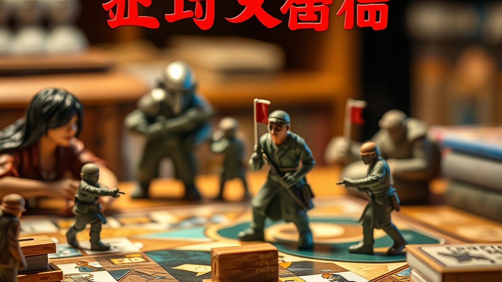

보드게임, 2026년의 트렌드는 '협동형 캠페인'이다. 20대 후반에서 40대까지의 키덜트 세대에게 보드게임은 이제 단순한 시간 때우기용 놀이를 넘어섰다. 텍스트와 이미지로 가득한 디지털 화면을 매일 10시간 이상 마주하는 우리에게, 보드게임은 물리적인 촉감을 통해 타인과 연결되는 가장 확실한 오프라인 창구가 되었다. 특히 최근의 흐름은 승패를 겨루는 경쟁형 게임에서, 모두가 하나의 목표를 향해 달려가는 협동형 캠페인 게임으로 급격히 이동하고 있다.

왜 지금인가? 직장과 일상에서 우리는 이미 충분히 경쟁하고 평가받는다. 퇴근 후나 주말에 모인 자리에서조차 누군가를 이겨야 한다는 압박감은 취미를 또 다른 업무로 변질시킨다. 반면, 협동형 캠페인 게임은 이야기가 중심이다. 정해진 시나리오 안에서 플레이어들은 팀원이 되어 난관을 헤쳐 나간다. 이 과정에서 발생하는 대화와 공통된 기억은 게임이 끝난 후에도 깊은 정서적 유대감을 남긴다. 이제 보드게임은 단순히 '누가 이기느냐'의 문제가 아니라 '우리가 어떤 서사를 함께 완성했느냐'의 문제로 변모했다. 지금부터 이 몰입감 넘치는 세계에 발을 들이려는 당신을 위해, 실패하지 않는 선택 기준과 운영 방식을 정리한다.

## 무엇을 기준으로 시작할 것인가: 협동형 게임 선택의 정석

협동형 캠페인 게임을 고를 때 가장 많이 하는 실수는 무작정 화려한 피규어나 구성품만 보고 구매하는 것이다. 캠페인 게임은 기본적으로 수십 시간을 투자해야 하는 '장기 프로젝트'다. 따라서 게임의 재미보다 '지속 가능성'을 먼저 따져야 한다. 

선택의 첫 번째 기준은 '플레이어의 고정 멤버십'이다. 캠페인 게임은 멤버가 바뀌면 흐름이 끊긴다. 만약 당신이 매주 목요일 저녁 3명의 친구와 고정적으로 만날 수 있다면, 긴 호흡의 서사 게임을 선택해도 좋다. 하지만 멤버가 유동적이라면 1회성으로 끝나는 협동 게임이나, 멤버가 바뀌어도 서사가 크게 훼손되지 않는 모듈형 게임을 선택해야 한다.

실패 사례를 하나 들어보겠다. 40만 원 상당의 방대한 세계관을 가진 대형 캠페인 게임을 구매한 뒤, 첫 세션에서 3시간 동안 규칙만 설명하다 지쳐버린 경우다. 결국 멤버들은 다음 약속을 잡지 않았고, 게임은 거실 한구석의 거대한 짐이 되었다. 이런 비극을 피하려면, 첫 시작은 규칙이 30분 이내로 설명 가능한 '입문용 시나리오 게임'으로 시작해야 한다.

선택 기준을 정리하자면 이렇다. 
1. 플레이 시간: 1회당 90분 이내로 끝나는가? (너무 길면 집중력이 깨진다.)
2. 세팅 난이도: 박스를 열고 플레이까지 15분 안에 가능한가? (세팅이 30분 넘어가면 준비 단계에서 지친다.)
3. 서사 방식: 텍스트 읽기 위주인가, 퍼즐 풀이 위주인가? (취향에 맞지 않는 방식은 고역이다.)

이 세 가지를 충족하는 게임을 선택해야 최소한 3회차까지는 완주할 수 있다. 

## 실전 체크리스트: 게임을 망치지 않는 운영 노하우

협동형 게임을 운영할 때 가장 중요한 것은 '게임 마스터'의 존재다. 여기서 말하는 게임 마스터는 규칙을 완벽히 숙지한 사람을 의미한다. 캠페인 게임은 규칙이 복잡해질수록 플레이어들이 게임보다 규칙 책자에 더 많은 시간을 뺏긴다. 

운영 시 주의할 점은 다음과 같다. 첫째, 규칙을 모두 외우려 하지 마라. 게임을 시작하기 전, 규칙의 핵심 흐름만 파악하고 게임 도중 발생하는 예외적인 상황은 상황별로 찾아보는 방식을 택하라. 둘째, '알파 플레이어'를 경계하라. 협동 게임에서 가장 흔한 실수인데, 한 명이 전략을 독점하고 다른 사람들에게 지시를 내리는 행위다. 이는 다른 플레이어의 재미를 완전히 앗아간다. 각자의 캐릭터가 가진 고유한 능력에 집중하게 하고, 결정적인 선택은 투표를 통해 결정하는 등 참여를 유도해야 한다.

실전 체크리스트:
- 규칙 숙지: 게임 시작 전, 한 명은 반드시 규칙 영상을 2회 이상 시청했는가?
- 캐릭터 배분: 각자의 역할이 게임 내에서 명확하게 체감되는가?
- 환경 조성: 게임판을 충분히 펼칠 수 있는 1200mm 이상의 테이블이 확보되었는가?
- 기록 관리: 캠페인 진행 상황을 기록할 수 있는 노트나 앱을 준비했는가?

이 체크리스트 중 하나라도 준비되지 않았다면, 그날의 플레이는 삐걱거릴 가능성이 크다. 특히 공간 확보는 무시하기 쉬운데, 캠페인 게임은 맵 확장이나 카드 배치가 많아 좁은 테이블에서는 몰입감이 급격히 떨어진다.

## 왜 우리는 2026년에 이 몰입에 열광하는가

디지털 시대의 역설이다. 기술이 발달할수록 우리는 오히려 '아날로그적 연결'에 목마르다. 협동형 캠페인 보드게임은 단순히 게임을 하는 행위가 아니라, 정해진 시간 동안 휴대폰을 끄고 같은 공간에서 같은 고민을 공유하는 '오프라인 의례'와 같다. 

이러한 취미는 비용 대비 효율이 매우 높다. 10만 원대의 게임 하나를 구매해 4명이 10회차를 즐긴다면, 회당 인당 2,500원꼴로 고품질의 서사 경험을 공유하는 셈이다. 이는 영화나 외식보다 훨씬 깊은 대화를 가능하게 한다. 게임 속에서 닥친 위기를 함께 극복하고 나면, 게임 밖에서의 인간관계도 한층 단단해진다. 이것이 키덜트들이 보드게임 커뮤니티를 찾아 나서고, 자신의 소장품을 공유하며, 오프라인 모임에 적극적으로 참여하는 이유다.

결론적으로, 협동형 캠페인 보드게임은 당신의 일상에 '함께 만들어가는 이야기'라는 새로운 활력을 불어넣어 줄 것이다. 지금 당장 거창한 게임을 사려고 고민하기보다는, 주변에 마음 맞는 친구 2~3명을 모아 규칙이 간결하고 서사가 탄탄한 2인~4인용 협동 게임을 하나 골라보라. 게임의 승패보다 중요한 것은, 그날 밤 우리가 함께 나눈 대화와 공유했던 고민의 깊이임을 금방 깨닫게 될 것이다. 보드게임은 단순한 물건이 아니라, 사람과 사람을 잇는 매개체라는 점을 기억하며 오늘부터 당신만의 첫 번째 캠페인을 시작해보길 권한다.

## 마치며

2026년 보드게임의 핵심 트렌드인 '협동형 캠페인'은 단순한 유희를 넘어, 깊이 있는 서사와 관계의 밀도를 선물합니다. 회당 저렴한 비용으로 영화 이상의 몰입감을 경험하며, 함께 위기를 헤쳐 나가는 과정에서 친구들과의 유대감은 한층 견고해집니다. 보드게임은 이제 혼자 소장하는 물건이 아니라, 사람과 사람의 마음을 잇는 가장 따뜻한 매개체가 되었습니다.

이제 여러분의 일상에도 소중한 사람들과 함께 써 내려갈 특별한 이야기를 더해보는 건 어떨까요? 거창한 시작이 아니어도 좋습니다. 마음 맞는 친구 2~3명과 함께 규칙이 간결하고 서사가 탄탄한 게임을 골라 오늘 바로 첫 번째 캠페인을 시작해 보세요. 게임의 승패보다 그날 밤 우리가 나누었던 대화와 웃음이 더 오래도록 기억에 남을 것입니다. 보드게임이 선사하는 이 새로운 활력이 여러분의 일상을 더욱 풍요롭게 채워주길 응원합니다. 지금 바로, 당신만의 모험을 시작해 보세요!
