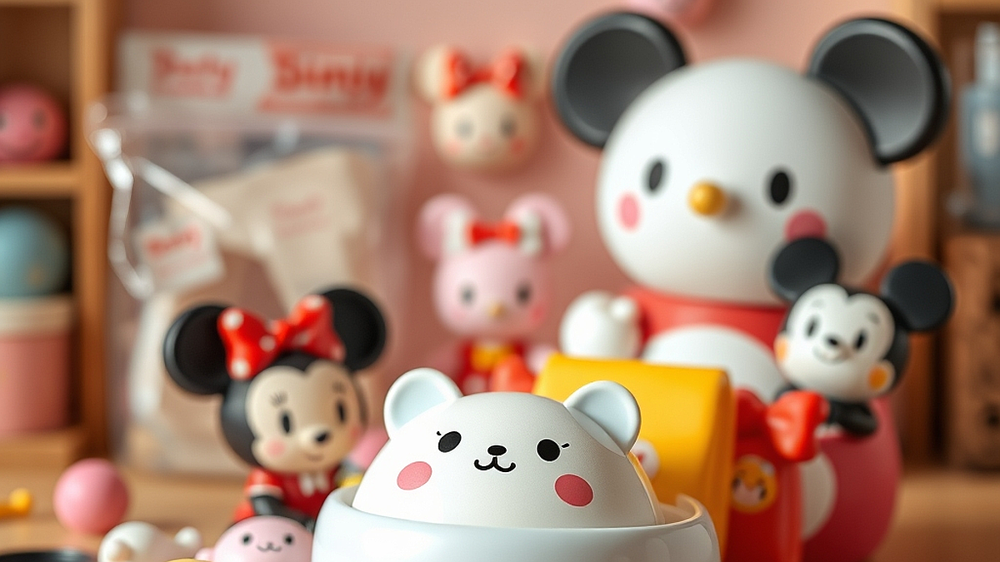

다이소 디즈니·산리오 콜라보의 진화는 단순히 저렴한 가격에 캐릭터를 입혔다는 사실을 넘어, 이제는 2040 세대의 세련된 취향과 공간 활용법을 파고드는 전략적 수집 문화로 자리 잡았습니다. 예전에는 5천 원짜리 굿즈라고 하면 조잡한 마감이나 유치한 디자인을 먼저 떠올렸지만, 최근 다이소의 행보는 다릅니다. 성인 수집가들의 눈높이에 맞춘 톤앤매너, 일상에서 자연스럽게 녹아드는 실용성, 그리고 한정판이라는 심리적 트리거가 결합하면서 덕질의 문턱을 획기적으로 낮췄습니다. 좁은 자취방에 거대한 피규어를 들여놓기 부담스러운 1인 가구에게, 다이소의 굿즈는 공간을 덜 차지하면서도 확실한 심리적 만족감을 주는 최적의 대안이 된 셈입니다. 이제 우리는 더 이상 비싼 돈을 주고 수입 피규어를 사 모으지 않아도, 5천 원이라는 예산 안에서 충분히 자신의 취향을 큐레이션하고 일상을 디자인할 수 있는 시대에 살고 있습니다. 오늘은 이 가성비 덕질이 왜 성인 수집가들에게 통하는지, 그리고 실패 없는 수집을 위해 무엇을 기준점으로 삼아야 할지 구체적으로 살펴보겠습니다.

## 성인 수집가가 다이소 굿즈를 선택하는 실질적 기준

성인 수집가에게 가장 큰 적은 예산보다 '공간'과 '조화'입니다. 아무리 예쁜 굿즈라도 내 방의 인테리어를 해치거나, 다른 고가의 수집품과 어울리지 않으면 결국 서랍 속으로 들어가기 마련입니다. 다이소의 캐릭터 콜라보는 이 지점에서 영리한 전략을 취합니다. 바로 '일상 소모품으로의 치환'입니다. 수집용 피규어는 먼지가 쌓이면 관리가 어렵지만, 다이소에서 내놓는 캐릭터 트레이, 수납함, 문구류는 실사용이 가능합니다.

선택의 기준은 명확해야 합니다. 첫째, '내 공간의 톤앤매너와 어울리는가'입니다. 원색 위주의 캐릭터 상품은 인테리어를 산만하게 만듭니다. 반면, 최근 다이소에서 선보이는 파스텔 톤이나 무채색 베이스의 캐릭터 굿즈는 성인들의 데스크테리어에 자연스럽게 스며듭니다. 둘째, '실사용 가능 여부'입니다. 단순히 장식용으로 두기만 하면 금방 질리지만, 매일 쓰는 마우스 패드나 정리함에 캐릭터가 있다면 볼 때마다 소소한 행복을 느낄 수 있습니다.

실패 사례를 하나 들어보겠습니다. 캐릭터가 크게 프린트된 플라스틱 수납함을 샀다가, 막상 방에 두니 너무 아이들 방처럼 보여 일주일 만에 처분한 경험이 있을 겁니다. 이는 캐릭터의 크기와 배경색을 고려하지 않은 선택 때문입니다. 선택 기준은 이렇습니다. '캐릭터가 전면이 아닌 측면에 작게 배치되었는가?', '본체 색상이 내 가구와 톤이 맞는가?'를 먼저 확인하세요. 이 두 가지만 따져도 수집의 만족도는 훨씬 올라갑니다.

## 가성비 덕질을 위한 실전 체크리스트와 수집 전략

저가형 굿즈 수집에서 가장 흔히 하는 실수는 '싸니까 다 산다'는 태도입니다. 5천 원이라는 가격은 개별적으로는 부담 없지만, 시리즈를 모두 쓸어 담으면 금세 수십만 원이 됩니다. 우리는 수집가이지, 단순한 물건 적재자가 아닙니다. 따라서 나만의 수집 테마를 정해야 합니다.

실전 체크리스트를 제안합니다. 매장에 가기 전 아래 항목을 스스로 질문해 보세요.

* 공간 확보: 이 물건을 둘 자리가 지금 즉시 마련되어 있는가? (빈 공간이 없다면 사지 마세요.)
* 활용도: 이 물건을 1주일에 최소 3번 이상 사용할 것인가? (장식용이라면 1달에 한 번씩 위치를 바꿀 자신이 있는가?)
* 대체 가능성: 이미 집에 비슷한 용도의 물건이 있는가? (캐릭터만 다를 뿐 기능이 같다면 수집의 목적을 다시 생각해야 합니다.)
* 마감 상태: 5천 원이라는 가격대에서 예상되는 마감 불량(도색 번짐, 유격 등)을 감당할 수 있는가?

수집의 난이도는 '시리즈 완성'을 목표로 할 때 급격히 올라갑니다. 특정 캐릭터의 모든 라인업을 모으겠다는 강박은 지양하세요. 대신 '데스크 셋업', '티타임', '문구 정리'처럼 테마를 정하고 그에 필요한 아이템만 선별적으로 구매하는 것이 훨씬 성숙한 수집 방식입니다. 

실수하기 쉬운 부분은 '오픈런'에 휩쓸리는 것입니다. 인터넷 커뮤니티에서 품절 대란이라는 글을 보고 급하게 매장을 돌면, 내 취향과 상관없는 물건까지 사 오게 됩니다. 다이소 굿즈는 생산량이 많아 재입고 주기가 비교적 짧습니다. 지금 당장 없다고 조급해하지 마세요. 수집의 즐거움은 '내가 선택한 물건이 내 공간에 들어왔을 때' 완성되는 것이지, 남들이 다 가진 물건을 나도 가졌다는 안도감에서 오는 것이 아닙니다.

## 수집 그 이상: 굿즈를 활용한 일상의 큐레이션

이제 굿즈는 단순히 모아두는 것이 아니라, 나의 생활 양식에 맞게 배치하고 사용하는 '큐레이션'의 영역입니다. 다이소에서 산 5천 원짜리 캐릭터 트레이에 매일 쓰는 차 키와 안경을 올려두는 것만으로도 나만의 작은 의식이 생깁니다. 이는 단순히 캐릭터를 좋아하는 행위를 넘어, 일상을 좀 더 다정하고 즐겁게 만드는 도구로 캐릭터를 활용하는 것입니다.

성인 수집가들에게 추천하는 방식은 '교체형 디스플레이'입니다. 좁은 공간을 효율적으로 쓰기 위해, 계절이나 기분에 따라 굿즈를 바꾸어 배치하세요. 예를 들어 봄에는 꽃무늬가 들어간 캐릭터 굿즈를 꺼내고, 겨울에는 포근한 재질의 패브릭 굿즈를 배치하는 식입니다. 이렇게 하면 물건을 계속 새로 사는 기분을 느낄 수 있으면서도, 실제로는 적은 수의 물건으로 공간을 알차게 활용할 수 있습니다.

마지막으로, 커뮤니티 활동에 대해 한마디 덧붙이자면, 타인의 컬렉션을 보며 자극을 받는 것은 좋지만 비교하지는 마세요. 누군가는 거실 전체를 굿즈로 채울 수도 있고, 누군가는 책상 위 작은 구석 한 곳만 꾸밀 수도 있습니다. 나의 공간과 예산, 그리고 취향에 맞는 '나만의 기준'을 세우는 것이 덕질을 오래 지속하는 비결입니다. 

결론적으로, 다이소의 캐릭터 굿즈는 우리에게 '적은 비용으로도 얼마든지 세련된 덕질이 가능하다'는 가능성을 열어주었습니다. 중요한 것은 가격이 아니라, 이 물건이 내 일상에 어떤 즐거움을 줄 수 있는지를 판단하는 안목입니다. 오늘 매장에 들른다면, 무작정 바구니에 담기보다는 내 책상 위나 선반을 한 번 떠올려 보세요. 그곳에 놓였을 때 내 기분을 좋아지게 할 딱 한 가지 물건만을 선택하는 연습, 그것이 바로 2040 세대가 지향해야 할 건강한 수집 문화입니다. 이제는 수집의 양이 아니라, 그 수집이 내 일상을 얼마나 다채롭게 만들고 있는지를 중심으로 덕질의 깊이를 더해 가시길 바랍니다.
