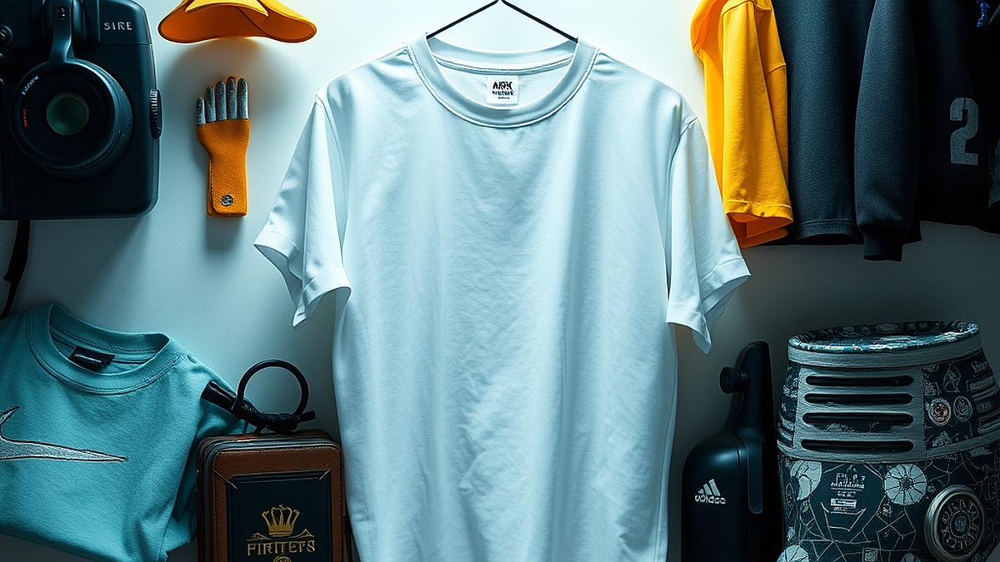

## 데이터 기반의 '개인화 굿즈', 알고리즘이 내 취향을 더 잘 안다?

데이터 기반의 개인화 굿즈 시장이 커지면서, 이제는 브랜드가 소비자의 장바구니보다 앞서 무엇을 살지 예측하는 시대가 되었습니다. 여러분도 경험해 보셨을 겁니다. 특정 아티스트나 캐릭터의 굿즈를 하나 구매하고 나면, 다음 날 SNS 광고창에 내가 고민하던 디자인과 정확히 일치하는 문구류나 소품이 뜨는 상황 말이죠. 과거에는 단순히 인기 있는 상품을 나열하는 방식이었다면, 지금의 개인화 알고리즘은 '내가 무엇을 좋아하는지'를 넘어 '내가 어떤 맥락에서 지갑을 여는지'를 파고듭니다. 하지만 선택지가 너무 많아지면서 오히려 무엇을 골라야 할지 모르는 결정 장애를 겪는 분들도 늘고 있습니다. 특히 한정판 굿즈나 커스터마이징 상품은 교환이나 환불이 어려운 경우가 많아 쇼핑의 피로도는 더욱 높죠. 오늘은 알고리즘이 제안하는 굿즈를 무비판적으로 수용하기보다, 내 취향의 명확한 기준을 세우고 똑똑하게 소비하는 방법을 실무적인 관점에서 짚어보려 합니다.

## 알고리즘이 내 취향을 파악하는 방식과 쇼핑의 함정

알고리즘은 여러분이 과거에 결제했던 이력, 상세 페이지에 머물렀던 시간, 심지어는 장바구니에 담았다가 삭제한 품목까지 분석합니다. 예를 들어, 제가 최근에 특정 브랜드의 미니멀한 데스크테리어 굿즈를 구매했다고 가정해 봅시다. 알고리즘은 즉시 제 구매 데이터를 기반으로 '색감이 비슷한 마우스 패드'나 '재질이 동일한 펜 트레이'를 추천 리스트 최상단에 올립니다. 브랜드 입장에서는 고객의 취향을 저격해 구매 전환율을 높이는 고마운 도구지만, 소비자 입장에서는 '취향의 굴레'에 갇힐 위험이 있습니다.

실패 사례를 하나 들어볼까요. 작년 연말, 저는 알고리즘이 추천한 '나만의 취향을 담은 다이어리 커스터마이징' 서비스를 이용했습니다. 평소 제가 자주 검색하던 키워드와 색상을 조합해 자동으로 제안된 디자인이었죠. 하지만 막상 받아보니 저의 실제 사용 습관과는 전혀 맞지 않는 구성이었습니다. 저는 다이어리를 휴대하며 기록하는 타입인데, 알고리즘은 단순히 제가 검색했던 '고급스러운 가죽'과 '무거운 금속 장식'을 조합해 제안했기 때문입니다. 알고리즘은 '이미지'는 읽었지만 '사용 맥락'은 읽지 못한 것입니다.

선택 기준은 명확합니다. 알고리즘이 제안하는 굿즈를 볼 때, **'이 디자인이 나의 라이프스타일과 부합하는가?'**를 먼저 자문해야 합니다. 단순히 화면에서 예뻐 보이는 것을 넘어, 나의 일상 공간에 실제로 배치했을 때의 동선과 사용성을 고려해야 합니다. 알고리즘은 '클릭'을 유도하지만, 우리는 '사용'을 생각해야 한다는 점을 잊지 마세요.

## 커스터마이징 굿즈, 실전 체크리스트

나에게 딱 맞는 굿즈를 고르기 위해선 데이터가 제안하는 '취향'을 필터링하는 나만의 체크리스트가 필요합니다. 제가 굿즈를 고를 때마다 스스로에게 던지는 질문 3가지를 공유합니다. 첫째, '이 제품이 나의 기존 소지품들과 조화를 이루는가?'입니다. 아무리 예쁜 굿즈라도 기존 환경과 따로 논다면 결국 서랍행이 됩니다. 둘째, '이 굿즈의 유지비는 얼마인가?'입니다. 예를 들어, 커스텀 인쇄가 들어간 텀블러는 전용 세척 도구가 필요하거나 특정 온도 이상에서 변색될 수 있습니다. 셋째, '이 굿즈를 사용하지 않게 되었을 때의 처분 방법은 무엇인가?'입니다.

실제 적용 사례를 들어보겠습니다. 최근 저는 좋아하는 브랜드의 로고가 들어간 에코백을 구매하려다 멈췄습니다. 알고리즘은 제 검색 이력을 바탕으로 가장 인기 있는 제품을 추천했지만, 저는 '이미 에코백이 3개나 있다'는 사실을 떠올렸습니다. 대신 그 브랜드에서 출시한 '파우치'를 선택했습니다. 에코백은 데이터가 제안한 '유행'이었지만, 파우치는 저의 '실질적 결핍'을 채워주는 아이템이었기 때문입니다.

실수하기 쉬운 부분은 '할인율'이나 '한정판'이라는 마케팅 문구에 휩쓸리는 것입니다. 데이터 마케팅은 종종 '마감 임박' 데이터를 이용해 조급함을 유발합니다. 이때는 반드시 24시간 동안 장바구니에 담아두고 기다려 보세요. 알고리즘이 제안하는 굿즈는 시간이 지나도 다시 광고로 노출될 확률이 높습니다. 그때까지도 이 물건이 정말 필요한지 고민하는 시간을 가지는 것이 쇼핑 실패를 줄이는 가장 확실한 방법입니다.

## 개인화 마케팅의 한계를 넘어서는 소비 주권

결국 데이터는 보조 도구일 뿐, 최종 의사결정은 소비자인 나의 몫입니다. 브랜드가 제공하는 개인화 추천은 우리가 모르는 새로운 취향을 발견하게 해주는 장점이 분명히 있습니다. 하지만 그 추천이 '내 일상'을 지배하게 두어서는 안 됩니다. 내가 어떤 상황에서 어떤 굿즈를 사용하고 싶은지, 그 목적이 분명할 때 알고리즘은 비로소 쓸모 있는 도구가 됩니다.

만약 여러분이 굿즈 구매를 고민 중이라면, 다음의 단계를 따라보세요. 첫째, 내가 지금 가장 불편함을 느끼는 지점이 무엇인지 적어봅니다. 둘째, 알고리즘이 추천하는 상품 중 그 불편함을 해소해 줄 수 있는 기능을 가진 것이 있는지 확인합니다. 셋째, 그 제품의 리뷰 중 '디자인'에 대한 칭찬 말고 '실제 사용감'에 대한 비판적 의견을 먼저 찾아봅니다. 이렇게 접근하면 무분별한 소비를 막고, 나만의 취향을 담은 만족스러운 굿즈를 손에 넣을 수 있습니다.

마지막으로 강조하고 싶은 점은, 굿즈는 결국 '나의 일상을 즐겁게 만드는 도구'라는 본질입니다. 데이터가 가리키는 방향이 곧 나의 정답은 아닙니다. 알고리즘이 제안하는 정보는 참고하되, 최종 선택의 기준은 언제나 나의 일상과 취향의 중심에 두시길 바랍니다. 지금 당장 장바구니에 담긴 물건들을 보며, 이것이 정말 내가 필요해서 고른 것인지, 아니면 알고리즘이 나를 유혹한 것인지 한번 점검해 보는 시간을 가져보세요. 그 작은 차이가 당신의 소비 생활을 훨씬 더 풍요롭고 가치 있게 만들어 줄 것입니다.

## 마치며

결국 데이터 기반의 개인화 굿즈는 우리의 취향을 발견해 주는 유용한 나침반일 뿐, 진짜 목적지를 정하는 주인공은 바로 '나 자신'입니다. 정교한 알고리즘이 내 마음을 꿰뚫어 보는 것처럼 매력적인 추천을 쏟아내더라도, 내 일상에 실질적인 기쁨과 편리함을 주지 못한다면 그저 스쳐 지나가는 예쁜 물건에 불과하니까요. 

이제 스마트폰을 켜고 쇼핑 앱의 장바구니를 가만히 들여다보세요. 그리고 결제 버튼을 누르기 전, 스스로에게 딱 한 가지만 질문해 보는 건 어떨까요? "이 물건은 정말 나의 필요와 취향에서 시작된 소비일까?" 

알고리즘의 영리한 유혹에 휩쓸리지 않고 내면의 목소리에 귀를 기울일 때, 비로소 내 라이프스타일을 진정으로 빛내줄 인생 굿즈를 만날 수 있습니다. 여러분의 반짝이는 취향과 똑똑한 소비 생활을 언제나 응원하며, 오늘 글이 의미 있는 소비를 위한 작은 길잡이가 되었기를 바랍니다. 다음에 더 유익한 이야기로 다시 만나요!
