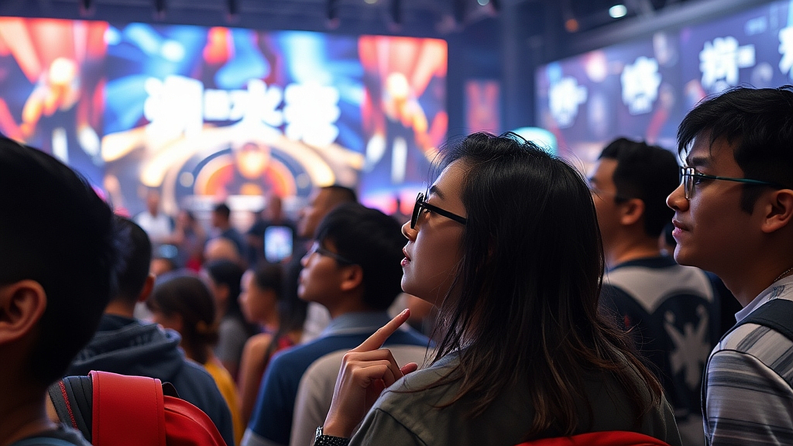

## 팬덤 마케팅의 진화: 굿즈를 넘어 '브랜드 세계관'에 참여하는 팬들

팬덤 마케팅의 진화는 이제 단순히 로고가 박힌 굿즈를 파는 단계를 지나, 브랜드가 설계한 세계관 속에서 팬들이 직접 역할을 수행하며 서사를 완성해가는 단계로 접어들었습니다. 예전에는 브랜드가 일방적으로 메시지를 던지고 팬들이 이를 소비했다면, 지금은 브랜드가 판을 깔고 팬들이 그 안에서 유저이자 창작자로 활동합니다. 하지만 많은 마케터가 여전히 '열성 팬'을 만들기 위해 굿즈의 퀄리티를 높이거나 할인 쿠폰을 뿌리는 데만 집중합니다. 이는 마치 맛있는 요리를 대접하겠다는 생각으로 식당을 열었는데, 손님들이 주방에 들어와 직접 요리하고 싶어 하는 욕구를 읽지 못한 것과 같습니다. 브랜드가 팬덤을 구축하려 한다면, 이제는 팬들에게 '어떤 역할을 부여할 것인가'를 고민해야 합니다. 브랜드의 세계관은 팬들이 머물 수 있는 공간이자, 그들이 자신의 취향을 증명할 수 있는 무대이기 때문입니다. 이 글에서는 브랜드가 팬덤과 관계를 맺는 구체적인 전략과, 단순 구매자를 열성 팬으로 전환하기 위한 실전 체크리스트를 살펴봅니다.

## 팬덤에게 부여하는 역할: 관객에서 기획자로의 전환

브랜드가 팬덤을 다룰 때 가장 큰 실수는 팬을 단순히 '물건을 사주는 사람'으로 규정하는 것입니다. 팬들은 브랜드가 제공하는 세계관 속에서 자신의 존재감을 확인하고 싶어 합니다. 예를 들어, 특정 라이프스타일 브랜드가 단순히 제품 기능만을 홍보한다면 팬들은 구매 후 바로 떠나버립니다. 하지만 브랜드가 '우리 제품을 활용해 나만의 공간을 꾸미는 사람'이라는 역할을 부여하고, 이를 커뮤니티 내에서 공유하게 만든다면 이야기는 달라집니다.

팬들에게 역할을 부여할 때는 '난이도'와 '보상'을 명확히 설정해야 합니다. 너무 쉬우면 금방 지루해지고, 너무 어려우면 참여 장벽이 생깁니다. 초기 단계에서는 브랜드가 제시하는 가이드라인 안에서 팬들이 자신의 개성을 드러낼 수 있는 '챌린지'나 '기획 참여' 형태가 효과적입니다.

실패하는 케이스는 대개 브랜드가 팬들의 창의성을 통제하려 할 때 발생합니다. 브랜드 컬러를 강요하거나, 지나치게 엄격한 가이드라인을 제시하면 팬들은 '브랜드의 꼭두각시'라는 느낌을 받습니다. 반면 성공적인 사례는 브랜드가 핵심 철학(Core Value)만 던져주고, 구체적인 실행 방식은 팬들에게 위임하는 경우입니다.

선택 기준은 명확합니다. 만약 여러분의 브랜드가 소셜 미디어를 통해 팬들의 2차 창작물을 자연스럽게 유도하고 있다면, 그들에게 공식적인 '앰배서더'나 '베타 테스터'라는 역할을 부여하십시오. 그들에게 브랜드의 성장에 기여하고 있다는 효능감을 주는 것이 핵심입니다.

## 실전 체크리스트: 우리 브랜드는 팬덤을 위해 무엇을 준비했나

브랜드 커뮤니티를 운영하거나 팬덤 마케팅을 시도할 때, 무작정 플랫폼을 개설하는 것은 위험합니다. 팬들이 모였을 때 그들이 '무엇을 해야 할지' 모르면 커뮤니티는 방치된 게시판이 됩니다. 다음은 실전에서 반드시 확인해야 할 체크리스트입니다.

첫째, 팬들이 서로 연결될 수 있는 '공통 언어'가 있는가? 브랜드만의 은어나 특정 상황에서 사용하는 행동 양식이 있어야 합니다. 둘째, 팬들의 활동이 브랜드에 실질적인 피드백으로 반영되는가? 팬들이 제안한 아이디어가 실제로 제품 개선이나 이벤트에 반영되는 과정을 보여주어야 합니다. 셋째, 브랜드가 팬덤의 성장을 응원하는가? 

실수하기 쉬운 부분은 '수치'에만 집착하는 것입니다. 팬덤의 규모가 커지는 것보다, 지금 있는 팬들이 얼마나 자주 브랜드 활동에 반응하는지가 훨씬 중요합니다. 1,000명의 눈팅족보다 10명의 열성적인 활동가가 브랜드 세계관을 유지하는 힘이 됩니다. 

선택 기준은 다음과 같습니다. 만약 여러분이 커뮤니티 관리에 매주 5시간 이상의 리소스를 투입할 여력이 없다면, 거창한 커뮤니티 플랫폼을 만들기보다 기존에 팬들이 모여 있는 소셜 미디어 채널에서 '댓글 소통'과 '리그램' 위주의 가벼운 관계 맺기부터 시작하십시오. 초기 팬덤은 양보다 밀도가 중요합니다.

## 브랜드 세계관 구축의 핵심 지표와 실패 시 점검법

브랜드 세계관은 단순히 멋진 스토리를 쓰는 것이 아니라, 팬들이 그 세계관 안에서 '놀 수 있는 규칙'을 만드는 것입니다. 이 규칙이 명확할 때 팬들은 소속감을 느낍니다. 마케팅 실무에서는 이를 측정하기 위해 '참여형 지표'를 활용해야 합니다. 단순 조회수나 좋아요는 거품일 가능성이 큽니다. 대신 '브랜드가 제시한 과제에 대한 팬들의 응답률'이나 '팬들끼리 자발적으로 생성한 콘텐츠의 수'를 추적하십시오.

실패했을 때 점검해야 할 순서는 다음과 같습니다. 첫째, 우리의 세계관이 너무 복잡하지 않은가? 팬들이 이해하고 참여하는 데 3분 이상 고민해야 한다면 실패입니다. 둘째, 팬들이 얻는 혜택이 브랜드의 이익보다 큰가? 팬들은 자신의 시간을 들여 브랜드 세계관에 참여합니다. 그들에게 브랜드 굿즈 이상의 '심리적 보상'이나 '커뮤니티 내 명성'을 제공하고 있는지 확인하십시오. 셋째, 브랜드가 팬들의 목소리를 경청하고 있는가? 팬덤의 반응을 무시하고 브랜드의 일방적인 메시지만 송출하고 있다면 즉시 중단해야 합니다.

실제 사례를 보면, 성공한 브랜드들은 팬들이 직접 제품의 이름을 짓거나, 다음 시즌 디자인의 방향성을 투표하게 하는 등 의사결정 과정에 팬들을 참여시킵니다. 이런 과정 자체가 하나의 콘텐츠가 되어 팬덤을 더욱 단단하게 묶어줍니다. 

결론적으로, 팬덤 마케팅은 브랜드가 팬들에게 '어떤 의미 있는 경험을 제공할 것인가'에 대한 답을 찾는 과정입니다. 단순히 제품을 판매하는 것을 넘어, 팬들과 함께 브랜드를 공동 창조한다는 관점을 가지십시오. 지금 바로 여러분의 브랜드가 팬들에게 어떤 역할을 부여하고 있는지, 그들이 즐겁게 놀 수 있는 판이 마련되어 있는지 점검하시기 바랍니다. 팬들은 브랜드의 로고를 소비하는 것이 아니라, 브랜드가 만드는 서사 속에서 자신을 발견하고 싶어 한다는 점을 잊지 마십시오. 작은 소통에서 시작된 관계가 결국 브랜드의 강력한 자산이 될 것입니다.

## 마치며

결국 팬덤 마케팅의 핵심은 일방적인 판매가 아닌, 팬들과 함께 브랜드라는 거대한 서사를 써 내려가는 ‘공동 창조’에 있습니다. 팬들을 단순한 소비자가 아닌 브랜드 세계관의 주인공으로 초대할 때, 비로소 브랜드는 강력한 생명력을 얻게 됩니다. 팬들이 마음껏 뛰어놀 수 있는 판을 깔아주고, 그들의 목소리를 의사결정의 중심에 두는 것. 그것이 지금 우리 브랜드가 나아가야 할 방향입니다.

지금 바로 여러분의 브랜드를 돌아보세요. 팬들에게 어떤 역할을 부여하고 계신가요? 그들이 브랜드와 함께하며 즐거움을 느끼고 있나요? 거창한 전략보다 중요한 것은 팬들과 나누는 작은 소통입니다. 오늘부터 팬들의 피드백에 귀를 기울이고, 그들이 브랜드의 이야기 속에서 자신만의 의미를 발견할 수 있도록 작은 참여의 기회를 만들어보세요. 여러분이 마련한 그 작은 소통의 장이, 머지않아 브랜드의 가장 든든하고 강력한 자산으로 돌아올 것입니다. 지금 바로 팬들과의 새로운 대화를 시작해보는 건 어떨까요?
