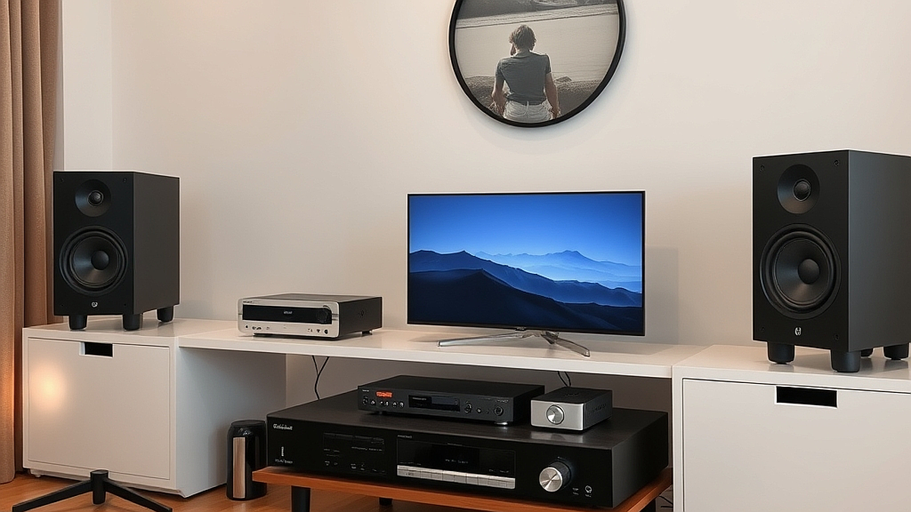

턴테이블 열풍 이후, 2026년 오디오파일러들이 주목하는 고음질 스트리밍의 미학은 더 이상 막연한 기술적 우월함을 논하는 데 머물지 않습니다. 과거 LP를 수집하고 바늘을 올리는 행위가 음악과 물리적으로 교감하는 의식이었다면, 오늘날의 고음질 스트리밍은 디지털 데이터 안에 숨겨진 아날로그적 질감을 어떻게 재발견하느냐의 문제로 옮겨갔습니다. 거실 한복판을 차지한 거대한 스피커 시스템 대신, 책상 위에서 완벽하게 세팅된 DAC와 고성능 이어폰이 그 자리를 대신하고 있죠. 우리는 여전히 음악을 배경음처럼 흘려보내는 일상에 지쳐 있습니다. 식사할 때 틀어놓는 플레이리스트가 아니라, 단 30분의 시간이라도 오롯이 소리의 결을 느끼고 싶어 하는 이들을 위해, 지금 당장 시작할 수 있는 고음질 스트리밍의 실전 가이드를 제시합니다.

## 고음질 스트리밍을 시작하기 전, 당신의 청취 환경부터 점검하세요

많은 이들이 고음질 스트리밍 서비스에 가입하면 곧바로 음질이 비약적으로 상승할 것이라 기대합니다. 하지만 이는 마치 낡은 모니터로 4K 영상을 보는 것과 같습니다. 가장 먼저 확인해야 할 것은 출력 장치의 한계입니다. 아무리 고해상도 음원을 가져와도, 이를 재생하는 이어폰이나 스피커가 그 정보를 처리하지 못하면 결국 일반 음원과 다를 바 없는 소리가 납니다.

실패하는 케이스는 명확합니다. 수십만 원을 호가하는 무선 노이즈 캔슬링 헤드폰만을 믿고 고음질 설정을 마치는 경우입니다. 블루투스 전송 과정에서 발생하는 데이터 압축 때문에 무손실 음원의 장점은 상당 부분 사라집니다. 만약 당신이 고음질을 제대로 경험하고 싶다면, 최소한 유선 연결을 지원하는 DAC(디지털-아날로그 변환기)를 거쳐야 합니다.

선택 기준은 단순합니다. 당신의 예산이 10만 원 미만이라면, 무리해서 고가의 고해상도 서비스를 구독하기보다 그 돈을 유선 이어폰의 이어 팁을 교체하거나, 스마트폰에 직접 연결하는 소형 USB DAC를 구매하는 데 투자하십시오. 이것이 고음질로 가는 가장 빠른 길입니다.

실전 체크리스트:
1. 사용 중인 이어폰이 유선 연결을 지원하는가?
2. PC나 스마트폰의 설정 메뉴에서 오디오 출력 품질을 최대치로 고정했는가?
3. 청취 환경이 너무 시끄럽지는 않은가? 고음질은 미세한 잔향을 즐기는 것이므로 최소한의 정숙함이 필요합니다.

## 디지털 음원을 아날로그처럼 느끼게 만드는 청취 습관

디지털 음원은 아날로그보다 차갑고 딱딱하다는 편견이 있습니다. 하지만 이는 데이터의 문제가 아니라 청취 습관의 문제입니다. 턴테이블의 매력은 음악이 시작되기 전의 노이즈와 바늘이 긁는 소리, 그리고 앨범 전체를 순서대로 들어야 하는 강제성에 있습니다. 스트리밍 환경에서도 이 '의식'을 도입해야 합니다.

가장 효과적인 방법은 셔플 재생을 끄는 것입니다. 아티스트가 의도한 앨범 트랙 순서는 소리의 기승전결을 고려해 배치되어 있습니다. 1번 트랙부터 마지막 곡까지 멈추지 않고 듣는 것은 음악을 배경이 아닌 주인공으로 만드는 첫걸음입니다. 또한, 볼륨을 평소보다 10%만 낮춰보십시오. 고음질 음원은 다이내믹 레인지가 넓어 큰 소리는 더 크게, 작은 소리는 더 섬세하게 들립니다. 볼륨을 조금 낮추면 오히려 귀가 덜 피로해지면서 악기 하나하나의 위치가 머릿속에 그려지는 경험을 할 수 있습니다.

실패 사례는 곡을 30초 듣고 마음에 들지 않아 넘기는 습관입니다. 고음질 스트리밍의 진가는 곡의 중반부, 악기들이 겹쳐지며 만들어내는 풍성한 공간감에 있습니다. 최소한 한 앨범의 3곡까지는 건너뛰지 말고 끝까지 감상하는 규칙을 세우십시오.

선택 기준:
- 당신이 즐겨 듣는 음악이 악기 구성이 복잡한 재즈나 클래식인가? 그렇다면 고해상도 스트리밍이 확실한 차이를 만들어냅니다.
- 반면, 비트 중심의 EDM이나 단순한 구성의 팝을 주로 듣는다면, 고음질 음원보다는 오히려 좋은 출력 장치(스피커의 배치 등)를 갖추는 것이 훨씬 경제적입니다.

## 장비의 함정에 빠지지 않는 실전 유지비와 공간 활용

오디오파일러의 길은 끝없는 장비 업그레이드의 늪처럼 보이기 쉽습니다. 하지만 2026년의 효율적인 오디오 소비는 '공간'과 '지속 가능성'에 있습니다. 거창한 앰프와 스피커를 들이기 전에, 당신의 책상 위 1평 남짓한 공간을 어떻게 활용할지 고민하십시오.

유지비 측면에서 고음질 스트리밍은 턴테이블보다 월등히 저렴합니다. LP 한 장 가격으로 몇 달간 고음질 서비스를 이용할 수 있습니다. 그러나 장비에 들어가는 비용은 다릅니다. 제가 추천하는 방식은 '단계적 업그레이드'입니다. 처음에는 스마트폰과 직결되는 소형 DAC 하나로 시작하십시오. 그다음은 이어폰의 케이블을 은선 등으로 교체해보는 식입니다. 이 과정에서 발생하는 비용은 수만 원에서 십수만 원 수준이며, 변화를 즉각적으로 체감할 수 있습니다.

실수하기 쉬운 부분은 무조건 비싼 장비가 좋다고 믿는 것입니다. 오디오 기기는 매칭이 중요합니다. 특정 브랜드의 이어폰은 특정 성향의 DAC와 만났을 때 소리가 너무 날카로워질 수 있습니다. 커뮤니티의 단순 추천글을 맹신하지 말고, 본인이 주로 듣는 장르의 음악을 가지고 매장에 방문해 직접 청음 하는 시간을 반드시 가져야 합니다.

최종 선택 기준:
- 1인 가구로서 공간이 좁다면, 무리한 스피커 구성보다는 하이엔드급 유선 이어폰과 DAC 조합을 선택하십시오.
- 가족과 함께 거주하거나 방음이 어려운 환경이라면, 고음질 스트리밍은 더욱 빛을 발합니다. 밤늦은 시간에도 작은 볼륨으로 스튜디오 녹음의 질감을 느낄 수 있기 때문입니다.

결론적으로, 고음질 스트리밍은 단순한 기술적 사치가 아닙니다. 음악을 대하는 태도를 바꾸고, 내 귀가 무엇을 좋아하는지 알아가는 과정입니다. 지금 바로 스마트폰의 스트리밍 설정에서 '최고 음질'을 선택하고, 평소 좋아하던 앨범 하나를 정해 셔플 없이 처음부터 끝까지 감상해보십시오. 장비는 그 이후에 고민해도 늦지 않습니다. 음악은 결국 데이터가 아닌, 당신의 몰입 속에서 비로소 완성되기 때문입니다. 오늘 밤, 당신의 플레이리스트가 어떻게 변할지 직접 확인해 보시기 바랍니다.

## 마치며

고음질 스트리밍은 단순한 기술적 과시가 아니라, 음악 본연의 감동을 온전히 마주하기 위한 진지한 태도입니다. 턴테이블의 아날로그 감성을 넘어, 이제는 고해상도 음원이 선사하는 미세한 숨결과 악기의 질감에 집중해 볼 차례입니다. 공간의 제약이나 장비의 부담 때문에 망설일 필요는 없습니다. 지금 가장 중요한 것은 당신의 취향을 확인하고, 음악에 깊이 몰입하는 시간 그 자체니까요.

오늘 바로 스마트폰 스트리밍 설정을 '최고 음질'로 변경하고, 평소 가장 아끼던 앨범을 골라 처음부터 끝까지 정주행해 보세요. 셔플 재생으로는 결코 느낄 수 없었던 아티스트의 의도와 숨겨진 디테일이 당신의 귀를 사로잡을 것입니다. 장비 업그레이드는 그다음의 문제입니다. 음악은 데이터가 아닌, 당신의 온전한 몰입 속에서 비로소 완성되기 때문입니다. 오늘 밤, 당신의 플레이리스트가 들려줄 새로운 풍경을 직접 경험해 보시길 바랍니다.
