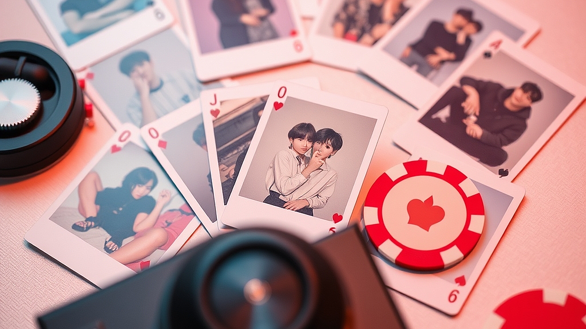

포토카드 수집은 과연 음악 소비인가, 도박인가라는 질문은 현재 K-POP 팬덤 내부에서 가장 뜨겁게 타오르는 논쟁이자, 동시에 누구나 한 번쯤 스스로에게 던져보았을 법한 딜레마입니다. 음악을 듣기 위해 앨범을 사는 시대는 지났습니다. 이제 CD는 고해상도 음원을 재생하기 위한 매체가 아니라, 내가 원하는 멤버의 사진 한 장을 얻기 위한 랜덤 확률 게임의 입장권으로 전락했습니다. 1만 원에서 2만 원 사이의 앨범을 수십 장씩 구매하여 팬 사인회 응모권을 챙기고, 중복된 CD는 길거리에 버려지거나 기부라는 명목으로 처리되는 풍경은 음악 산업의 기형적인 단면을 보여줍니다. 과연 우리가 지금 구매하는 것은 음악일까요, 아니면 확률에 베팅하는 굿즈일까요? 이 글에서는 포토카드 수집 문화가 음악 소비와 어떻게 다른 지점을 가지는지, 그리고 팬으로서 어떻게 건강한 소비의 선을 지킬 수 있을지 실전적인 기준을 제시하고자 합니다.

## 음악 소비와 굿즈 수집의 경계: 무엇을 위해 지갑을 여는가

음악 소비의 본질은 청각적 경험과 그에 따르는 정서적 교감에 있습니다. 하지만 현재의 앨범 마케팅은 청각적 경험을 부차적인 것으로 밀어내고, 시각적 수집 욕구를 최우선 순위에 둡니다. 만약 당신이 앨범을 구매하는 이유가 좋아하는 가수의 음악을 고음질로 소장하고 싶어서라면, 이는 정당한 음악 소비입니다. 그러나 특정 멤버의 포토카드를 얻기 위해 앨범을 대량 구매하는 행위는 본질적으로 '수집형 게임'의 영역에 가깝습니다.

선택 기준은 명확합니다. 앨범을 구매하기 전, '이 앨범에 수록된 곡들이 내 플레이리스트에 얼마나 자주 올라올 것인가'를 스스로 물어보십시오. 만약 CD를 뜯지도 않고 포토카드만 확인한 뒤 보관함에 넣는다면, 그것은 음악 소비가 아니라 굿즈 수집입니다. 실패 사례로, 한정판이라는 이유만으로 10장 이상의 앨범을 구매했다가 결국 음악은 한 번도 재생하지 않고 포토카드만 중고 거래 플랫폼에 판매하는 경우가 많습니다. 이는 투자 대비 회수율이 현저히 낮을 뿐만 아니라, 물리적인 공간만 차지하는 불필요한 소비입니다.

실전 체크리스트를 제안합니다. 첫째, 앨범 수록곡 중 최소 3곡 이상을 반복해서 들을 의향이 있는가? 둘째, 포토카드를 제외하고 앨범 디자인이나 화보집 자체에 소장 가치를 느끼는가? 셋째, 앨범을 보관할 물리적 공간이 확보되어 있는가? 이 세 가지 질문 중 하나라도 '아니오'가 나온다면, 해당 앨범은 당신의 음악 취향을 만족시키기보다는 수집의 늪으로 이끌 가능성이 높습니다.

## 포토카드 확률 게임의 실체와 대안적 소비 전략

포토카드 수집은 확률적 도박과 유사한 심리적 기제를 이용합니다. '이번에는 원하는 멤버가 나올지 모른다'는 기대감은 도파민을 분비시키고, 이는 반복적인 앨범 구매로 이어집니다. 문제는 이 과정이 음악 산업의 지속 가능성을 해친다는 점입니다. 앨범이 판매량 지표를 올리는 도구로만 쓰일 때, 음악의 완성도는 뒷전이 되기 쉽습니다.

구체적인 대안은 '직접 뽑기'가 아닌 '확실한 구매'입니다. 포토카드 수집이 목적이라면, 앨범을 무작위로 수십 장 구매하는 대신 중고 거래 플랫폼이나 팬덤 커뮤니티에서 원하는 카드를 개별적으로 구매하는 것이 훨씬 경제적입니다. 예를 들어, 앨범 10장을 구매하는 데 드는 비용이 15만 원이라면, 그 돈으로 원하는 포토카드 5~6장을 확실하게 구할 수 있습니다. 이렇게 하면 불필요한 CD 쓰레기를 만들지 않으면서도 수집의 목적을 달성할 수 있습니다.

실수하기 쉬운 부분은 '랜덤의 설렘'을 '소비의 즐거움'으로 착각하는 것입니다. 운에 맡기는 소비는 통제력을 잃기 쉽습니다. 따라서 예산 관리 기준을 세워야 합니다. 한 달에 굿즈 구매에 사용할 수 있는 금액을 정하고, 그 예산 안에서만 거래하십시오. 만약 당신이 학생이거나 경제적 독립을 준비하는 단계라면, 앨범 구매는 '음악 청취'를 목적으로 한 1장으로 제한하고, 포토카드는 차후에 여유가 생겼을 때 구매하는 것을 권장합니다.

## 팬덤 문화와 환경적 책임: 지속 가능한 음악 감상을 위하여

우리의 소비 습관은 곧 산업의 방향을 결정합니다. 팬덤이 앨범을 대량으로 구매하는 행태가 지속되면, 기획사는 음악의 질보다 포토카드의 종류를 늘리는 데 집중하게 됩니다. 이는 결국 음악을 사랑하는 팬들에게는 손해입니다. 음악적 깊이가 없는 앨범은 시간이 지나면 가치가 떨어지지만, 잘 만든 음악은 시간이 흘러도 회자되기 때문입니다.

환경적 책임 또한 간과할 수 없습니다. 수만 장의 플라스틱 CD가 버려지는 현실은 결코 가볍게 볼 문제가 아닙니다. 최근에는 디지털 앨범이나 플랫폼 앨범처럼 플라스틱 사용을 최소화한 형태가 등장하고 있습니다. 이런 대안을 선택하는 것은 팬으로서 할 수 있는 가장 적극적이고 실천적인 의사표시입니다. 환경을 생각하는 소비는 당신의 팬 활동을 더욱 가치 있게 만듭니다.

마지막으로, 당신의 음악 취향을 존중하는 소비를 하십시오. 음악은 누군가에게는 위로이고, 누군가에게는 삶의 활력소입니다. 포토카드는 그 음악을 기억하기 위한 부가적인 기념품일 뿐입니다. 앨범을 쌓아두는 것보다, 그 음악을 통해 어떤 감정을 느꼈는지를 기록하고 공유하는 것이 훨씬 건강한 팬덤 문화입니다. 오늘 당장 앨범을 구매하기 전에, 내가 정말 이 음악을 소장하고 싶은지, 아니면 단지 포토카드의 확률에 기대어 불안한 만족감을 얻으려 하는지 다시 한번 점검해 보시기 바랍니다. 당신의 소중한 예산과 공간을 낭비하지 않는 것이야말로, 진정으로 가수를 아끼고 음악을 사랑하는 길입니다.

## 마치며

결국 아이돌 앨범은 음악을 담는 그릇이어야지, 포토카드라는 '확률형 아이템'을 얻기 위한 수단으로 전락해서는 안 됩니다. 앨범을 대량으로 구매해 버려지는 플라스틱 쓰레기는 환경 문제를 넘어, 음악의 본질적 가치를 흐리게 만듭니다. 우리는 이제 앨범을 물리적으로 소유하는 행위를 넘어, 음악을 진심으로 감상하고 아티스트의 메시지를 깊이 있게 소비하는 성숙한 팬덤 문화를 고민해야 할 때입니다.

이제는 변화가 필요한 시점입니다. 무분별한 앨범 구매 대신 친환경적인 플랫폼 앨범을 선택하거나, 포토카드에 매몰되기보다 음악 자체의 감상을 기록하고 공유하는 건강한 팬 활동을 시작해 보는 건 어떨까요? 당신의 소중한 시간과 예산이 단순히 운을 시험하는 곳이 아니라, 진정으로 좋아하는 음악과 아티스트를 응원하는 데 쓰일 때 팬덤 문화는 더욱 빛날 것입니다. 오늘부터는 수집의 욕구를 잠시 내려놓고, 음악이 주는 위로에 더 집중해 보세요. 여러분의 건강하고 가치 있는 팬 활동을 진심으로 응원합니다!
