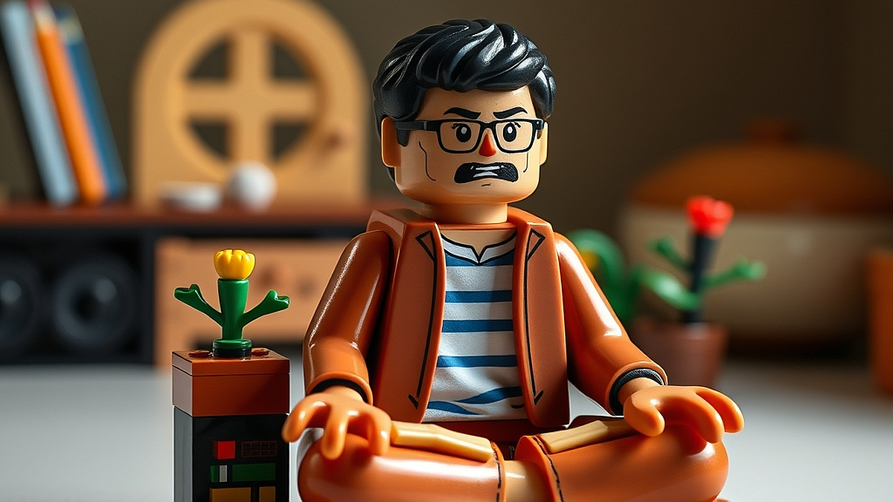

레고 어른이 라인업의 비밀: 10만 원이 넘는 블록이 스트레스 해소용 명상이 되는 이유는 무엇일까요? 퇴근 후 현관문을 열고 들어왔을 때, 뇌의 전두엽은 이미 방전 상태입니다. 유튜브 쇼츠를 넘기거나 넷플릭스를 띄워놓고 멍하니 있는 것은 사실 휴식이 아니라, 쏟아지는 자극에 대한 또 다른 형태의 피로 누적입니다. 이때 10만 원을 호가하는 레고 박스를 꺼내 조립을 시작하는 행위는 단순한 장난감 놀이가 아닙니다. 이것은 일종의 '오프라인 명상'입니다. 

디지털 세상에서 우리는 끊임없이 선택하고 반응해야 하지만, 레고는 정해진 설명서에 따라 물리적인 조각을 맞추는 명확한 규칙을 제공합니다. 잡념이 끼어들 틈이 없는 조립 과정은 뇌의 과부하를 막아주고, 완성된 결과물은 성취감을 줍니다. 오늘 이 글에서는 왜 성인들이 이 비싼 플라스틱 조각에 지갑을 여는지, 그리고 이 취미를 진정한 멘탈 케어 수단으로 삼으려면 어떤 점을 고려해야 하는지 현실적인 관점에서 짚어보려 합니다.

## 무엇이 어른들을 10만 원짜리 블록 앞에 앉히는가

많은 이들이 레고를 아이들의 전유물로 생각하지만, 지금의 성인용 라인업은 명확히 '정서적 안정'을 타겟으로 설계되었습니다. 우리가 레고를 선택하는 핵심 이유는 '통제 가능한 환경'에 있습니다. 직장 생활은 내 마음대로 되지 않는 일들의 연속이지만, 레고는 매뉴얼대로만 따라가면 반드시 완벽한 결과물이 나옵니다. 이 예측 가능성이 주는 심리적 안정감은 꽤 큽니다.

선택의 기준은 '공간'과 '조립 시간'입니다. 10만 원 이상의 제품은 대개 1,000피스 내외의 볼륨을 가집니다. 이를 조립하는 데는 숙련도에 따라 5시간에서 10시간 정도가 소요됩니다. 만약 당신이 좁은 원룸에 살거나 집중력이 짧은 편이라면, 거대한 테크닉 시리즈보다는 아기자기한 식물 시리즈나 건축물 시리즈를 권합니다. 

실패하는 사례는 대부분 '무작정 멋있어 보이는 것'을 샀다가 조립 도중 압도당하는 경우입니다. 수천 개의 부품이 섞인 봉지를 뜯고 나면, 조립이 취미가 아니라 노동처럼 느껴지기 때문입니다. 처음 시작한다면 15만 원 이하의, 조립 후 선반 한 칸에 쏙 들어가는 사이즈부터 시작하는 것이 좋습니다. 그래야 '완성해서 전시한다'는 보상을 빠르게 얻고 다음 단계로 넘어갈 수 있습니다.

## 몰입을 위한 실전 체크리스트: 무엇을 피해야 하는가

레고를 스트레스 해소용으로 쓰려면 반드시 피해야 할 함정이 있습니다. 첫째, '가성비'에 집착하지 마세요. 부품 수 대비 가격을 따지기 시작하면 이것은 취미가 아니라 투자 상품 분석이 됩니다. 둘째, 조립 공간을 확보하지 않은 채 구매하지 마세요. 식탁이나 책상을 조립하는 동안 점거해야 하는데, 공간이 정리되지 않으면 오히려 스트레스가 쌓입니다.

여기서 중요한 실전 체크리스트를 제안합니다. 

1. 조립 환경: 최소 60cm x 60cm의 평평한 공간이 확보되었는가?
2. 조립 시간: 한 번에 1시간 이상 몰입할 수 있는 시간대가 있는가? (주말 오전 혹은 금요일 밤 권장)
3. 보관 계획: 완성 후 먼지를 털거나 전시할 장소가 있는가?
4. 예산 여유: 생활비를 쪼개서 사는 것이 아니라, 온전히 나를 위한 '문화비'로 설정했는가?

이 기준 중 하나라도 '아니오'가 나온다면 구매를 잠시 미루세요. 특히 전시 공간이 없는 상태에서 무리하게 큰 모델을 사면, 조립 후 오히려 처치 곤란한 짐이 되어 스트레스를 유발합니다. 또한, 남들이 좋다고 해서 무조건 인기 모델을 따라 사는 것도 금물입니다. 본인이 평소에 자동차를 좋아하는지, 건축물을 좋아하는지, 아니면 영화 속 세계관을 좋아하는지에 따라 만족도는 천차만별입니다.

## 조립 그 이후: 수집이 아닌 멘탈 케어의 지속 가능성

조립이 끝난 뒤의 레고는 그저 먼지 쌓인 플라스틱 덩어리가 될 수도 있고, 내 공간의 분위기를 바꾸는 인테리어 오브제가 될 수도 있습니다. 멘탈 케어의 관점에서 레고의 진정한 가치는 '완성 후의 감상'에 있습니다. 내가 직접 손으로 만든 결과물이 내 방 한구석을 지키고 있다는 사실은 묘한 효능감을 줍니다.

지속적인 취미로 삼고 싶다면, 정기적인 '로테이션'을 추천합니다. 모든 레고를 한꺼번에 전시하는 것이 아니라, 계절이나 기분에 따라 전시하는 모델을 바꾸는 방식입니다. 조립했던 것을 다시 분해해서 박스에 담아두고, 몇 달 뒤에 다시 조립하는 것도 좋습니다. 레고는 그 자체로 영구적인 자산이기에 가능한 방식입니다.

마지막으로, 커뮤니티 활동은 선택 사항입니다. 레고 전문 커뮤니티는 정보 공유에는 유용하지만, 남들의 거대한 컬렉션과 나를 비교하기 시작하면 즐거움은 사라집니다. 레고는 타인에게 보여주기 위한 전시용이 아니라, 조립하는 과정에서 얻는 '나만의 정적인 시간'을 구매하는 행위임을 잊지 마세요. 

결론적으로, 레고는 뇌를 비우고 손을 움직이는 현대적인 수행입니다. 10만 원이라는 가격은 단순히 블록 값이라기보다, 그 시간 동안 스마트폰을 내려놓고 온전히 자신에게 집중할 수 있는 '방해받지 않을 권리'를 사는 비용이라고 생각하십시오. 지금 당장 거창한 모델을 사려고 고민하기보다, 오늘 밤 1시간 동안 조용히 집중할 수 있는 작은 세트 하나부터 시작해 보길 권합니다. 완성 후 책상 위에 놓인 결과물을 보며 느끼는 작은 뿌듯함이, 내일의 당신을 버티게 하는 또 하나의 작은 힘이 될 것입니다.

## 마치며

레고는 단순히 플라스틱 블록을 조립하는 취미를 넘어, 복잡한 일상에서 벗어나 오롯이 나에게 집중하는 현대적인 명상법입니다. 10만 원이 넘는 가격은 단순히 제품의 가치가 아니라, 스마트폰의 알림에서 벗어나 온전히 나만의 고요한 시간을 확보하는 ‘방해받지 않을 권리’를 사는 비용과 같습니다. 남들과 비교하기보다 조립하는 과정 그 자체의 즐거움에 집중해 보세요. 

거창한 컬렉션을 완성하겠다는 부담감은 잠시 내려놓으셔도 좋습니다. 오늘 밤, 책상 위에서 1시간 동안 조용히 손끝의 감각에 몰입할 수 있는 작은 세트 하나를 골라보는 건 어떨까요? 블록을 하나씩 쌓아 올리며 비워지는 머릿속과 완성 후 마주하는 작은 성취감이, 내일을 살아갈 소중한 에너지가 되어줄 것입니다. 지금 바로, 당신만의 고요한 수행을 시작해 보세요.
