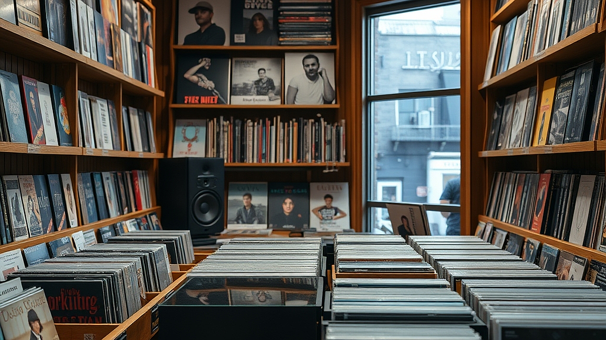

# LP 샵이 서점이 된 이유, 음악과 책이 만드는 '취향의 공간'

LP와 서점이라는 두 키워드는 이제 단순히 물건을 파는 장소를 넘어, 개인의 취향을 밀도 있게 응축하는 공간의 대명사가 되었습니다. 주말 오후, 습관처럼 들르던 음반 가게가 어느덧 큐레이션 서점으로 탈바꿈해 있는 모습을 보며 우리는 묘한 안도감을 느낍니다. 단순히 음악을 듣고 책을 읽는 행위를 넘어, 그 음악이 담긴 시대적 맥락을 책을 통해 읽고, 책의 여백을 음악으로 채우는 일련의 과정이 하나의 '취향 소비'로 정착했기 때문입니다. 하지만 막상 이런 공간을 찾아 나서면 어디서부터 무엇을 즐겨야 할지 막막할 때가 많습니다. 단순히 예쁜 인테리어를 구경하는 것에서 그치지 않고, 나의 음악적 취향을 확장하고 책과 음악이 교차하는 지점에서 새로운 영감을 얻고 싶은 분들을 위해 오늘 이 글을 씁니다.

## 음악과 책을 함께 소비하는 공간의 선택 기준

음악과 책이 공존하는 공간을 고를 때 가장 먼저 확인해야 할 점은 '공간의 목적성'입니다. 어떤 곳은 LP를 배경음악으로 틀어놓고 서적을 판매하는 인테리어 위주의 공간인 반면, 어떤 곳은 특정 장르의 음악과 그에 어울리는 인문학 서적을 긴밀하게 연결해 큐레이션합니다. 본인의 목적이 단순한 '휴식'인지, 아니면 '새로운 지적 탐구'인지에 따라 선택은 달라져야 합니다.

구체적인 선택 기준은 다음과 같습니다. 음악을 감상할 수 있는 청음 시설의 수준이 중요한지, 아니면 책을 읽을 수 있는 좌석의 편의성이 우선인지 스스로에게 물어보세요. 청음 시설이 빈약한 곳에서 음악적 깊이를 기대하는 것은 무리이며, 반대로 서적의 종류가 지나치게 적은 곳에서 깊이 있는 독서를 기대하는 것도 어렵습니다.

**실패 케이스:** 소위 '인스타 감성'만을 쫓아 방문하는 경우입니다. 조명과 인테리어는 훌륭하지만, 정작 음악과 책 사이에 아무런 맥락이 없는 공간은 30분도 지나지 않아 지루해집니다. 책의 서가와 음악의 플레이리스트가 따로 노는 느낌을 받는다면 그곳은 당신의 취향을 확장해주지 못합니다.

**선택 기준:** 해당 공간의 운영자가 직접 작성한 큐레이션 문구가 있는지 확인하세요. 단순히 베스트셀러를 나열하는 것이 아니라, "이 앨범을 들으며 읽기 좋은 책"처럼 구체적인 제안을 건네는 곳이 당신의 취향을 넓혀줄 확률이 높습니다. 만약 운영자의 주관이 뚜렷하게 드러나는 공간이라면, 그곳은 단순한 상점이 아니라 하나의 '취향 공동체'로서 기능하고 있을 가능성이 큽니다.

## 실전 체크리스트: 음악과 책의 조화를 경험하는 법

공간에 들어섰다면 이제 본격적으로 즐길 차례입니다. 하지만 많은 이들이 서가 앞에서 무엇을 골라야 할지, 어떤 음악을 들어야 할지 우왕좌왕하다가 나옵니다. 이때 필요한 것은 나만의 '연결 고리'를 찾는 과정입니다.

먼저, 본인이 가장 좋아하는 음악 장르 하나를 정하고 그와 연관된 서적을 찾아보세요. 예를 들어 재즈를 좋아한다면 재즈 뮤지션의 전기나 재즈의 역사를 다룬 서적을, 클래식을 좋아한다면 악기론이나 음악사 관련 서적을 선택하는 식입니다. 여기서 중요한 것은 음악의 소리를 직접 확인하는 과정입니다.

### 음악과 책을 연결하는 3단계 절차
1. **장르 정하기:** 오늘 내가 깊게 파고들 음악 장르를 하나 고릅니다.
2. **서적 매칭:** 해당 장르의 음악가나 시대적 배경을 다룬 책을 서가에서 찾습니다.
3. **교차 감상:** 책의 내용을 읽으며 해당 앨범을 턴테이블에 올립니다. 이때 가사가 없는 연주곡이라면 책의 문장에 더 집중할 수 있고, 가사가 있는 곡이라면 음악의 감정선이 책의 내용과 어떻게 겹치는지 관찰합니다.

**실수하기 쉬운 부분:** 한꺼번에 너무 많은 정보를 처리하려는 욕심입니다. 낯선 음악을 들으며 낯선 책을 읽는 것은 생각보다 에너지가 많이 소모됩니다. 처음에는 이미 익숙한 앨범을 틀어놓고 새로운 책을 읽거나, 반대로 잘 아는 책의 구절을 읽으며 새로운 음악을 들어보는 방식으로 난이도를 조절하세요. 처음부터 완벽한 조화를 찾으려 하기보다, 음악이 책의 몰입도를 방해하지 않는지, 혹은 책의 내용이 음악의 해석을 어떻게 바꾸는지 그 변화 자체를 즐기는 것이 핵심입니다.

## 취향의 공간에서 얻는 지속 가능한 감각

이러한 공간을 방문하는 것만으로 취향이 완성되지는 않습니다. 진짜 취향은 그곳에서 얻은 영감을 일상으로 가져와 반복할 때 비로소 내 것이 됩니다. 공간에서 들었던 음악과 읽었던 책의 조화가 좋았다면, 그 리스트를 메모해두고 집으로 돌아와 비슷한 구성을 시도해보세요. 

비용 측면에서 보면, LP는 한 장당 3~5만 원, 책은 1.5~2만 원 선입니다. 매번 구매하기 부담스럽다면 공간에서 제공하는 청음 서비스와 열람용 도서를 최대한 활용하세요. 매주 한 번, 특정 공간을 방문해 2시간 정도를 온전히 음악과 책에 할애하는 것만으로도 충분한 경험이 쌓입니다. 

**유지비 및 시간 관리:** 
- **시간:** 최소 2시간(음반 한 장의 러닝타임과 책 한 챕터의 호흡을 고려할 때 적절한 시간).
- **비용:** 공간 이용료나 음료비(평균 1만 원 내외).
- **준비물:** 스마트폰 대신 필기구와 노트를 챙기세요. 그날 느낀 감상과 음악의 제목, 책의 구절을 기록하는 것만으로도 추후 나만의 '취향 아카이브'가 됩니다.

이런 공간들은 당신에게 정답을 주지 않습니다. 대신 무엇을 질문해야 할지 알려줍니다. "이 음악은 왜 이 책과 어울리는가?"라는 질문을 스스로 던질 수 있게 된다면, 당신은 이미 취향의 주도권을 쥔 사람입니다. 타인의 추천에 의존하기보다, 직접 두 매체를 겹쳐 놓고 느껴지는 미묘한 공명에 귀를 기울여보세요. 

결론적으로, LP 샵이 서점이 된 공간은 단순히 물건을 파는 곳이 아니라, 음악과 책이라는 두 개의 언어가 만나 새로운 문장을 만들어내는 실험실과 같습니다. 오늘 당장 근처의 복합 문화 공간을 찾아, 평소 즐겨 듣던 음악과 평소 읽고 싶었던 책 한 권을 들고 그곳으로 향해 보길 권합니다. 음악의 진동이 책의 문장을 타고 흐를 때, 비로소 당신만의 취향이 선명해지는 순간을 경험하게 될 것입니다. 공간의 문을 여는 것은 당신의 몫이지만, 그 안에서 발견할 당신의 취향은 그 어떤 소비보다 값진 자산이 될 것입니다.

## 마치며

LP 샵과 서점이 결합한 공간은 단순히 상품을 판매하는 곳을 넘어, 음악과 책이 만나 새로운 영감을 빚어내는 창의적인 실험실입니다. 이곳에서 우리는 타인의 취향을 소비하는 대신, 두 매체의 공명을 통해 스스로 질문을 던지고 자신만의 색깔을 찾아가는 과정을 경험하게 됩니다. 기록된 취향은 훗날 삶을 풍요롭게 만드는 소중한 아카이브가 될 것입니다.

오늘, 평소 즐겨 듣던 음악 리스트와 읽고 싶었던 책 한 권을 챙겨 가까운 복합 문화 공간으로 떠나보는 건 어떨까요? 음악의 진동이 문장 사이를 파고드는 순간, 막연했던 당신의 취향은 더욱 선명해질 것입니다. 공간의 문을 여는 것은 당신의 작은 발걸음에서 시작되지만, 그 안에서 발견할 당신만의 고유한 세계는 그 어떤 소비보다 값진 자산이 되어줄 것입니다. 이번 주말, 당신만의 취향을 발견하는 특별한 여정을 시작해 보세요.
