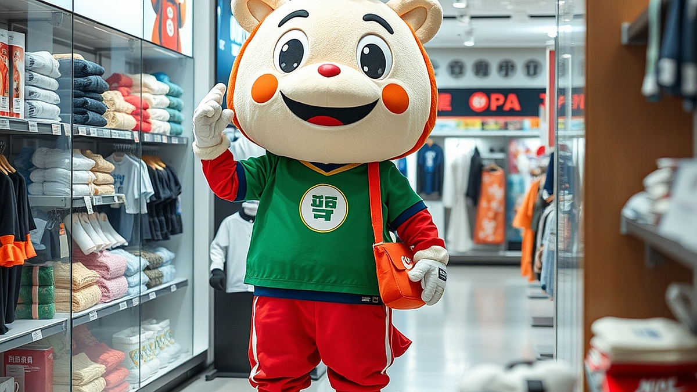

## 캐릭터 IP 라이선싱의 재발견: 무신사와 편의점이 마스코트 굿즈에 사활을 건 이유

IP 비즈니스가 유통업계의 핵심 생존 전략으로 자리 잡으면서, 이제 기업들에게 캐릭터는 단순히 귀여운 마스코트를 넘어 브랜드의 팬덤을 붙잡아두는 강력한 '락인(Lock-in)' 도구가 되었습니다. 무신사 같은 패션 플랫폼이 팝업 스토어를 통해 자체 캐릭터를 선보이고, 편의점들이 유명 애니메이션이나 게임 캐릭터와 손잡고 굿즈를 쏟아내는 이유는 명확합니다. 단순히 물건을 파는 것만으로는 고객의 일상을 점유할 수 없기 때문입니다. 오늘날 소비자는 브랜드의 기능보다 그 브랜드가 제공하는 '놀이의 경험'을 소비합니다. 캐릭터는 그 놀이의 가장 효율적인 통로입니다. 하지만 많은 브랜드가 단순히 로고만 박힌 인형이나 문구류를 찍어내는 실수를 범합니다. 정작 중요한 것은 캐릭터가 고객의 취향과 브랜드의 정체성 사이에서 어떤 연결 고리를 만드는가입니다. 이 글에서는 브랜드가 캐릭터 IP를 도입할 때 마주하는 현실적인 문제와, 밑 빠진 독에 물 붓기가 되지 않기 위한 실전 마케팅 기준을 제시합니다.

## 캐릭터 도입 전 점검해야 할 3가지 선택 기준

캐릭터를 활용한 마케팅을 고민할 때 가장 먼저 확인해야 할 것은 '우리 브랜드가 고객의 삶에 얼마나 자주 침투해 있는가'입니다. 캐릭터 굿즈는 그 자체로 완성된 상품이 아니라, 고객의 일상 속에 브랜드를 스며들게 하는 매개체여야 합니다. 

첫째, 고객의 구매 주기와 캐릭터 활용 빈도를 맞추어야 합니다. 편의점은 매일 방문하는 곳이기에 캐릭터를 활용한 식음료 패키지 변경만으로도 즉각적인 반응을 얻습니다. 반면, 고가의 가전이나 가구 브랜드가 캐릭터를 도입한다면, 제품 자체보다는 제품을 사용하는 환경(예: 데스크테리어)에 녹아드는 작은 소품이 적합합니다. 

둘째, '놀이 욕구'의 수준을 파악해야 합니다. 단순히 캐릭터가 그려진 쇼핑백을 주는 것은 이벤트에 불과합니다. 고객이 직접 캐릭터를 꾸미거나, 굿즈를 수집하기 위해 특정 미션을 수행하게 만드는 등 '참여'의 요소가 포함되어야 합니다. 무신사가 팝업 스토어에서 자체 캐릭터를 활용해 포토존을 구성하고, 그곳에서 찍은 사진이 SNS로 확산되게 만드는 것이 대표적입니다. 

셋째, 초기 비용 대비 효율을 따져야 합니다. 캐릭터 IP 라이선싱은 외부 IP를 빌려오는 방식과 자체 캐릭터를 개발하는 방식으로 나뉩니다. 외부 IP는 즉각적인 팬덤을 유입시키지만, 계약 기간 종료 후 자산으로 남지 않습니다. 자체 캐릭터는 초기 개발과 인지도 확산에 시간이 걸리지만, 장기적으로 브랜드 자산이 됩니다. 

실패 사례를 보면, 단순히 유행하는 캐릭터와 콜라보를 진행하면서 브랜드의 기존 톤앤매너를 완전히 무시하는 경우가 많습니다. 캐릭터는 귀엽지만 브랜드의 제품은 투박하다면, 고객은 부조화를 느끼고 구매를 망설입니다. 선택 기준은 명확합니다. 브랜드의 핵심 타겟이 '캐릭터를 수집하는 재미'를 느끼는 연령대와 성향을 가졌는가, 그리고 그 캐릭터가 브랜드의 가치를 훼손하지 않고 확장할 수 있는가를 먼저 확인하십시오.

## 실전 체크리스트: 굿즈 마케팅이 '쓰레기'가 되지 않으려면

굿즈를 만들 때 가장 흔히 저지르는 실수는 '우리 로고가 크게 박혀야 한다'는 강박입니다. 고객은 광고판을 들고 다니고 싶어 하지 않습니다. 그들은 자신의 취향을 대변하거나, 실용적인 가치를 제공하는 물건을 원합니다. 

다음은 제가 실무에서 굿즈를 기획할 때 반드시 확인하는 체크리스트입니다. 

1. 일상성: 이 굿즈를 집이나 사무실에서 실제로 매일 사용하는가? (예: 볼펜, 마우스패드, 텀블러)
2. 심미성: 로고를 가려도 내 방 인테리어와 어울리는 디자인인가?
3. 희소성: 지금 당장 구하지 않으면 얻을 수 없는 '한정판'의 명분이 있는가?
4. 확장성: 캐릭터의 세계관이 브랜드의 서비스와 연결되는가?

많은 브랜드가 굿즈 제작에 예산을 쏟아붓지만, 정작 '왜 이 물건을 사야 하는가'에 대한 답을 주지 못합니다. 예를 들어, 무신사가 플랫폼 내에서 특정 캐릭터 굿즈를 판매할 때, 단순히 캐릭터 인형만 파는 것이 아니라 '캐릭터가 입고 있는 옷'을 실제 브랜드 제품으로 기획하는 방식을 취합니다. 이렇게 되면 캐릭터는 단순한 장식물이 아니라, 브랜드의 상품을 홍보하는 모델이자 고객의 구매 욕구를 자극하는 콘텐츠가 됩니다.

실패하는 케이스는 대개 '재고 처리용 굿즈'입니다. 로고만 대충 박아 사은품으로 배포하는 방식은 고객에게 브랜드 가치를 낮추는 인상을 줍니다. 캐릭터 IP를 도입할 때는 반드시 '판매 가능한 수준의 퀄리티'를 목표로 해야 합니다. 직접 판매할 자신이 없는 굿즈라면 고객도 가치를 느끼지 못합니다. 굿즈는 브랜드가 고객에게 건네는 일종의 '취향의 증명서'여야 합니다. 이를 위해서는 기획 단계에서부터 고객이 이 물건을 들고 SNS에 인증샷을 올릴 만한 요소가 있는지, '예쁜 쓰레기'가 되지 않기 위해 실용적인 기능을 하나라도 갖췄는지 확인해야 합니다.

## 실패를 줄이는 IP 비즈니스 단계별 실행 절차

캐릭터 IP를 도입하기로 결정했다면, 다음의 3단계를 통해 리스크를 관리하십시오. 

1단계: 파일럿 테스트. 처음부터 대규모 굿즈를 생산하지 마십시오. 스티커, 엽서, 키링 등 소량 생산이 가능한 제품으로 고객의 반응을 살핍니다. 이 단계에서는 실제 판매를 통해 고객이 캐릭터에 얼마만큼의 지갑을 여는지 데이터를 확인하는 것이 핵심입니다. 

2단계: 세계관 구축. 캐릭터에게 이름을 붙이고, 성격과 배경 이야기를 만드십시오. 브랜드의 서비스가 어려울 때 캐릭터가 해결사로 등장하는 식의 스토리텔링이 필요합니다. 편의점들이 캐릭터를 활용해 '이달의 상품'을 소개하는 콘텐츠를 만드는 것이 바로 이러한 세계관 구축의 과정입니다. 

3단계: 피드백 루프. 굿즈를 출시한 후에는 고객의 구매 후기뿐만 아니라, SNS에서 어떤 방식으로 캐릭터가 활용되는지 모니터링하십시오. 고객이 캐릭터를 변형하거나 2차 창작물을 만든다면 그것은 성공의 신호입니다. 

마케팅 비용을 측정할 때는 단순히 굿즈 제작비를 광고비로 생각하지 말고, '고객 획득 비용(CAC)'과 '고객 생애 가치(LTV)'의 관점에서 접근해야 합니다. 캐릭터를 통해 브랜드에 유입된 고객이 재구매를 일으키는지, 그들이 커뮤니티에서 우리 브랜드를 언급하는 빈도가 늘어났는지를 지표로 삼아야 합니다. 

마지막으로 당부하고 싶은 점은, 캐릭터는 브랜드의 보조 수단이지 본질이 아니라는 사실입니다. 서비스나 제품의 품질이 뒷받침되지 않는 상태에서 캐릭터만 앞세우는 것은 모래 위에 성을 쌓는 것과 같습니다. 캐릭터 IP 라이선싱은 브랜드가 가진 매력을 증폭시키는 확성기입니다. 우리 브랜드가 가진 고유의 매력을 먼저 정의하고, 그 매력을 가장 잘 전달할 수 있는 캐릭터의 형태를 고민하십시오. 지금 당장 예산이 부족하다면 외부 IP와의 콜라보를 통해 시장의 반응을 먼저 테스트하고, 그 경험을 토대로 자체 캐릭터 개발을 고려하는 것이 가장 안전한 순서입니다. 브랜드의 마케팅은 결국 고객의 마음을 얻는 과정이며, 캐릭터는 그 마음을 여는 가장 부드러운 열쇠가 될 것입니다.

## 마치며

결국 캐릭터 IP는 단순히 귀여운 이미지를 소비하는 것을 넘어, 브랜드와 고객 사이의 정서적 거리를 좁히는 강력한 연결 고리입니다. 무신사나 편의점의 사례처럼 캐릭터를 활용한 마케팅은 브랜드에 생명력을 불어넣고, 고객의 충성도를 높이는 핵심 전략이 될 수 있습니다. 하지만 기억하세요. 캐릭터는 브랜드의 본질을 담아내는 그릇일 뿐, 그 본질을 대체할 수는 없습니다. 튼튼한 제품과 서비스라는 뿌리 위에 캐릭터라는 꽃이 피어날 때, 비로소 고객의 마음속에 오래도록 기억되는 브랜드가 완성됩니다.

이제 여러분의 차례입니다. 지금 우리 브랜드가 가진 고유한 매력은 무엇인가요? 당장 거창한 캐릭터를 만들기보다, 우리 브랜드와 가장 잘 어울리는 작은 시도부터 시작해보세요. 외부 IP와의 협업을 통해 고객의 반응을 살피는 것도 좋은 첫걸음입니다. 고객에게 다가가는 가장 부드럽고 따뜻한 열쇠, 캐릭터 IP를 통해 여러분만의 브랜드 이야기를 새롭게 써 내려가 보시길 바랍니다. 오늘 바로 고객의 마음을 열 준비가 되셨나요?
