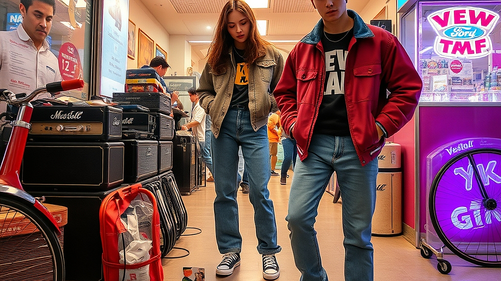

# 뉴진스 음악과 Y2K 레트로 패션이 어른들의 추억 조작을 성공시킨 마케팅 메커니즘

Y2K, 뉴트로, 감성 마케팅은 단순히 지나간 시절을 재현하는 유행을 넘어, 이제는 구매 결정권을 쥔 3040 세대의 지갑을 여는 가장 강력한 비즈니스 언어가 되었습니다. 특히 뉴진스라는 아티스트가 보여준 음악적 문법과 비주얼은 단순히 10대 팬덤만을 겨냥한 것이 아닙니다. 오히려 90년대 후반과 2000년대 초반, PC 통신과 MP3 플레이어를 경험했던 세대에게 '그때 그 시절'의 감각을 최신 기술로 재구성해 전달함으로써 강력한 '추억 조작'을 성공시켰습니다. 

많은 이들이 이를 단순한 복고라고 치부하지만, 실상은 다릅니다. 소비자는 더 이상 낡은 것을 그대로 소비하지 않습니다. 그들은 세련되게 다듬어진 과거의 조각을 통해 현재의 자아를 확인하고 싶어 합니다. 오늘 이 글에서는 왜 지금의 레트로 트렌드가 3040 세대의 마음을 흔드는지, 그리고 우리가 소비하는 굿즈와 콘텐츠 경험이 어떤 메커니즘으로 연결되는지 비즈니스적 관점에서 파헤쳐 보겠습니다. 단순히 향수에 젖는 것을 넘어, 여러분의 취향 소비가 어떻게 마케팅의 정교한 설계 위에서 이루어지는지 구체적인 체크리스트를 통해 확인해 보시기 바랍니다.

## 1. 감각의 재배치: 익숙함에 낯설음을 더하는 기술

마케팅에서 가장 경계해야 할 지점은 '과거의 성공 방식을 그대로 가져오는 것'입니다. 3040 세대가 열광하는 Y2K 스타일은 과거의 것을 복제하는 것이 아니라, 당시의 핵심 감각을 현대의 미니멀리즘과 결합한 형태입니다. 예를 들어, 2000년대 초반의 굵은 폰트와 원색적인 컬러를 가져오되, 이를 정돈된 레이아웃의 웹사이트나 깔끔한 굿즈 패키지에 적용하는 식이죠. 

이런 방식은 소비자에게 '익숙한 편안함'과 '새로운 세련미'를 동시에 제공합니다. 하지만 여기서 실패하는 케이스도 분명합니다. 과거의 로고나 캐릭터를 단순히 크게 배치하기만 하는 '굿즈'들은 금방 외면받습니다. 소비자들은 자신의 일상 공간에 그 굿즈를 놓았을 때, 주변 인테리어와 조화를 이루는지를 먼저 판단합니다. 

* 선택 기준: 굿즈를 구매할 때 '이것이 내 책상 위의 다른 물건들과 이질감 없이 섞이는가?'를 자문하십시오. 만약 굿즈가 너무 튀어서 독립적인 공간을 차지해야만 한다면, 그것은 소장용일 뿐 일상용은 아닙니다.
* 실패 케이스: 유행하는 빈티지 필터를 씌운 사진을 무분별하게 남발하는 콘텐츠는 오히려 브랜드의 신뢰도를 떨어뜨립니다. 
* 실전 팁: 과거의 디자인 언어를 차용할 때는 색상 팔레트를 3가지 이하로 제한하고, 폰트의 크기를 줄이는 것만으로도 훨씬 현대적인 감각을 유지할 수 있습니다.

## 2. 팬덤의 확장: 굿즈가 아닌 '경험의 조각'을 파는 법

과거의 팬덤은 아티스트의 사진이 박힌 브로마이드를 사는 것에 그쳤다면, 지금의 팬덤은 아티스트가 세계관 속에서 사용하는 물건을 함께 공유하는 '경험의 동기화'를 원합니다. 뉴진스의 마케팅이 성공한 지점은 음악뿐만 아니라 그들이 뮤직비디오에서 보여주는 사소한 소품, 의상, 심지어는 그들이 사용하는 디지털 기기의 UI까지도 하나의 '굿즈'로 기능하게 만들었다는 점입니다.

이것은 3040 세대에게도 똑같이 적용됩니다. 우리가 특정 브랜드의 굿즈를 사는 이유는 그 브랜드가 가진 서사를 내 삶의 일부로 가져오고 싶기 때문입니다. 이때 소비자는 단순히 물건을 사는 것이 아니라, 그 물건을 통해 자신이 그 브랜드의 가치관과 연결되어 있다는 소속감을 구매합니다.

* 핵심 기준: 굿즈를 선택할 때 '이 물건이 나의 어떤 라이프스타일을 보조하는가?'를 확인해야 합니다. 단순히 디자인이 예뻐서 사는 것이 아니라, 내가 평소에 즐기는 음악 감상 환경이나 작업 공간에 실질적으로 도움이 되는지 따져봐야 합니다.
* 측정 지표: 여러분이 어떤 브랜드의 굿즈를 3개월 이상 꾸준히 사용하고 있다면, 그것은 성공적인 '취향 소비'를 하고 있다는 확실한 지표입니다. 반대로 한 번 쓰고 서랍에 넣어두었다면, 그것은 마케팅에 의한 충동구매였을 가능성이 큽니다.
* 경험 설계: 브랜드는 소비자가 굿즈를 개봉하는 순간부터 일상에 배치하는 과정까지의 '언박싱 경험'을 설계해야 합니다. 이것이 결여된 상품은 소비자의 기억에서 빠르게 잊힙니다.

## 3. 실전 체크리스트: 여러분의 취향 소비를 점검하세요

레트로 트렌드가 주류로 자리 잡은 지금, 우리는 자신의 소비가 정말 나의 취향인지, 아니면 마케팅이 심어놓은 향수의 조각인지 냉정하게 판단해야 합니다. 다음은 제가 개인적인 소비를 결정할 때 사용하는 기준입니다. 여러분도 자신의 구매 패턴을 아래 항목으로 점검해 보시기 바랍니다.

### 소비 결정 전 체크리스트
1. **공간 점유도**: 이 물건이 내 생활 공간(책상, 침실, 가방)에서 차지하는 부피가 만족감에 비례하는가?
2. **사용 빈도 예측**: 최소 주 2회 이상 손이 갈 것인가? (예: LP 플레이어는 예쁘지만 관리가 힘들다면, 블루투스 스피커가 나을 수 있습니다.)
3. **사회적 연결성**: 이 물건을 사용할 때 내가 생각하는 나의 정체성이 드러나는가?
4. **유지 비용**: 단순히 구매 가격뿐만 아니라, 관리(청소, 배터리 교체, 소모품 구매)에 들어가는 시간과 노력을 감당할 수 있는가?

### 피해야 할 상황
- SNS에서 본 예쁜 이미지 하나만 보고 상세 페이지의 스펙을 확인하지 않는 경우.
- 한정판이라는 단어에 휩쓸려 내 공간과 어울리지 않는 색상을 선택하는 경우.
- 음악이나 콘텐츠 자체보다 '굿즈를 모으는 행위' 자체가 목적이 되어버린 경우.

이런 체크리스트는 비단 물건 구매에만 국한되지 않습니다. 우리가 소비하는 음악, 디지털 콘텐츠, 심지어는 구독 서비스까지도 이 기준을 적용하면 훨씬 명확한 판단이 가능합니다. 3040 세대가 레트로에 열광하는 이유는 과거의 완벽한 재현을 원해서가 아니라, 복잡한 현대 사회에서 가장 나다웠던 시절의 감각을 현재의 삶에 안전하게 이식하고 싶기 때문입니다. 

결국 마케팅은 소비자의 기억 속에 잠들어 있는 '가장 좋았던 시절의 감각'을 끄집어내어, 현재의 기술과 트렌드라는 그릇에 담아주는 작업입니다. 뉴진스가 Y2K를 재해석한 방식처럼, 여러분도 자신의 취향을 맹목적으로 따르지 말고, 그것이 현재의 내 삶과 어떻게 조화를 이룰지 고민해 보시길 바랍니다. 소비는 단순한 지출이 아니라, 나의 취향을 구체화하는 가장 확실한 기록입니다. 오늘부터는 여러분의 공간에 놓인 물건 하나하나가 어떤 서사를 담고 있는지, 그 이유를 스스로에게 질문해 보는 것은 어떨까요? 그 질문이 쌓일 때 비로소 진정한 의미의 '취향 소비'가 완성될 것입니다.

## 마치며

뉴진스의 음악과 Y2K 패션이 세대를 관통하며 사랑받는 이유는 단순히 과거를 복제했기 때문이 아닙니다. 이는 과거의 향수를 현대적인 감각으로 재해석하여, 우리 내면의 가장 빛나던 시절을 현재의 일상으로 안전하게 불러왔기 때문입니다. 결국 성공적인 마케팅은 소비자의 기억 속 소중한 감각을 건드려, 현재의 삶과 조화롭게 연결하는 작업이라 할 수 있습니다.

이제 여러분의 차례입니다. 단순히 유행을 뒤쫓기보다, 내가 소비하는 물건과 콘텐츠가 내 삶에 어떤 서사를 더하고 있는지 스스로 질문해보세요. 여러분이 오늘 선택한 작은 물건 하나가 사실은 가장 ‘나다운’ 삶을 기록하는 소중한 조각이 될 것입니다. 오늘부터 나의 취향을 더 깊이 들여다보는 ‘취향 소비’를 시작해보는 건 어떨까요? 여러분의 일상이 더 풍성하고 의미 있는 이야기들로 채워지길 진심으로 응원합니다.
