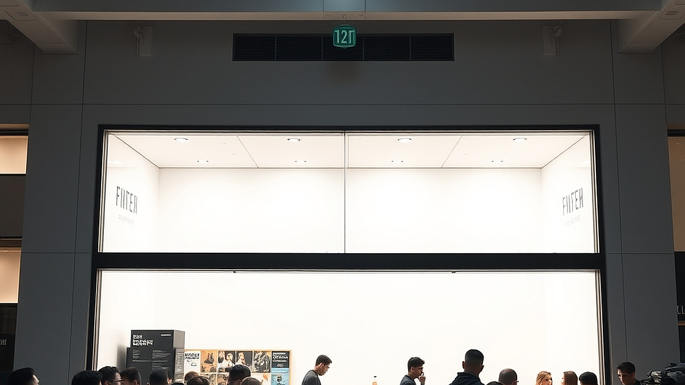

팝업스토어 피로도의 시대, 실패하는 브랜드와 대기 3시간을 불사하게 만드는 브랜드의 차이는 결국 방문객에게 '내가 왜 이곳에 서 있어야 하는가'라는 질문에 얼마나 명쾌한 대답을 주느냐에 달려 있습니다. 매주 주말 성수동이나 홍대 거리를 걷다 보면, 텅 빈 공간에 로고만 크게 박아두고 사진 몇 장 찍으면 끝나는 팝업스토어를 쉽게 마주합니다. 이런 곳들은 인스타그램에 올릴 그럴듯한 사진 한 장은 건질지 몰라도, 브랜드의 철학이나 제품의 본질을 기억하게 하지는 못합니다. 소비자는 이미 영리해졌습니다. 단순한 인증샷은 이제 놀이의 절반도 채우지 못하며, 사람들은 자신의 시간 3시간을 내어줄 만큼 강력한 서사와 체험적 보상을 원합니다.

마케팅 실무자로서 현장을 관찰해보면, 성공하는 팝업스토어는 방문객의 '취향'과 '놀이 욕구'를 아주 정교하게 건드립니다. 그들은 공간을 단순히 제품을 파는 매대가 아니라, 브랜드가 제안하는 라이프스타일을 관객이 직접 연기해보는 '무대'로 설계합니다. 반면 실패하는 브랜드는 여전히 '브랜드가 하고 싶은 말'을 공간에 가득 채우는 데 급급합니다. 이번 글에서는 팝업스토어의 홍수 속에서 우리가 진짜 시간과 에너지를 쏟을 가치가 있는 곳을 구별하는 기준과, 브랜드가 공간 기획 시 반드시 고려해야 할 실전 체크리스트를 정리해 드립니다.

## 포토존 너머의 서사: 체험의 깊이가 대기 시간을 결정한다

대기 3시간을 견디게 만드는 팝업스토어의 첫 번째 공통점은 '개연성 있는 서사'입니다. 단순히 예쁜 조명을 설치한 포토존은 10분이면 질리지만, 브랜드의 세계관 속에 관객을 주인공으로 던져넣는 기획은 1시간의 대기조차 '입장 전의 설렘'으로 치환합니다. 예를 들어, 어떤 주류 브랜드가 팝업스토어를 열 때 단순히 술을 시음하게 하는 것이 아니라, '비밀스러운 지하 바'라는 컨셉 아래 입장권을 암호로 대체하고, 그 암호를 찾아내기 위해 공간 곳곳을 탐험하게 만드는 식입니다.

반면 실패하는 사례는 '사진 찍기 좋은 곳'이라는 홍보 문구에만 집착합니다. 이런 곳들은 공간의 밀도가 낮습니다. 입구에서 사진을 찍고 나면 내부에는 딱히 할 일이 없어 5분 만에 퇴장하게 되는데, 이는 브랜드 입장에서는 고객을 붙잡아둘 기회를 날리는 것이고, 방문객 입장에서는 '인스타용 사진은 건졌지만 허무한' 경험이 됩니다.

**실전 체크리스트: 방문 전 확인해야 할 3가지**
1. 입장 방식이 단순 줄 서기인가, 아니면 사전 예약이나 현장 미션이 포함된 능동적 방식인가? (미션이 있다면 몰입도가 높을 확률이 큼)
2. 공간의 규모 대비 체류 시간이 얼마나 보장되는가? (단순 굿즈 판매대라면 10분 컷)
3. 브랜드 제품을 단순히 전시하는가, 아니면 제품이 만들어지는 과정이나 철학을 체험형 콘텐츠로 풀어냈는가?

선택 기준은 명확합니다. 브랜드의 제품을 이미 잘 알고 있는 사람에게는 '한정판 굿즈'를 주는 곳이 좋고, 브랜드를 처음 접하는 사람에게는 '브랜드의 서사'를 체험하게 하는 곳이 훨씬 가치 있습니다. 전자가 아니라면 굳이 3시간을 기다릴 이유는 없습니다.

## 마케팅의 실패를 결정짓는 결정적 실수: 공간의 목적성 상실

많은 브랜드가 팝업스토어를 기획할 때 저지르는 가장 큰 실수는 '목적의 불일치'입니다. 브랜드 인지도를 높이고 싶은지, 신제품을 판매하고 싶은지, 혹은 기존 고객에게 감사를 표하고 싶은지 목적이 분명해야 하는데, 이를 뒤섞어 놓으면 방문객은 무엇을 해야 할지 몰라 방황합니다. 

실패하는 팝업스토어는 '무엇이든 다 보여주려다 아무것도 기억에 남지 않는' 경우입니다. 1층에는 굿즈를 팔고, 2층에는 카페를 열고, 3층에는 전시를 배치하는 식으로 공간을 쪼개면 방문객은 어떤 브랜드인지 정의하기 어려워집니다. 반면 성공하는 브랜드는 단 하나의 메시지에 집중합니다. 예를 들어, 특정 향수 브랜드가 '나만의 향 찾기'라는 단 하나의 목적을 위해 공간 전체를 큐레이션한다면, 방문객은 그곳에서 자신의 취향을 발견하는 경험을 하게 됩니다.

**실패했을 때 점검해야 할 체크리스트**
1. 방문객이 입장해서 퇴장할 때까지 '딱 한 가지' 기억할 수 있는 브랜드의 키워드가 존재하는가?
2. 공간의 이동 동선이 브랜드의 서사를 따라가는가, 아니면 단순히 인파를 분산시키기 위한 미로인가?
3. 직원의 응대 방식이 브랜드의 톤앤매너와 일치하는가? (친절함보다 중요한 것은 세계관 유지)

만약 팝업스토어에서 브랜딩과 판매라는 두 마리 토끼를 다 잡으려 한다면, 판매는 반드시 '체험의 결과물'로 연결되어야 합니다. 체험 없이 물건만 쌓아놓은 곳은 팝업스토어가 아니라 그냥 '임시 매장'일 뿐입니다. 방문객은 팝업스토어에 갈 때 '쇼핑'이 아니라 '경험 소비'를 하러 간다는 점을 잊지 마세요.

## 실무자의 관점에서 본 팝업스토어 판단 기준: 누가 가야 하는가

마지막으로 팝업스토어의 성공 여부를 가르는 핵심은 '타겟의 명확성'입니다. 모든 사람을 만족시키려는 팝업스토어는 사실상 아무도 만족시키지 못합니다. 

**누구에게 맞는 팝업스토어인가?**
- 브랜드와 평소 긍정적인 관계를 맺고 있는 팬덤: 브랜드를 깊이 있게 이해하고 굿즈에 지갑을 열 준비가 된 사람들입니다.
- 특정 라이프스타일을 추구하는 얼리어답터: 새로운 트렌드를 가장 먼저 경험하고 기록하고 싶은 사람들입니다.

**피해야 할 경우**
- 홍보 문구에 '인생샷', 'SNS 대란'이라는 단어만 가득하고 브랜드의 정체성이 보이지 않는 곳.
- 대기 시간은 긴데, 막상 들어가서 할 수 있는 것이 사진 촬영 외에 전무한 곳.
- 입장료를 받으면서 그에 상응하는 경험적 보상(굿즈, 샘플, 깊이 있는 전시)이 없는 곳.

성공적인 팝업스토어는 방문객에게 '내가 이 브랜드의 팬이 되어도 좋겠다'는 확신을 줍니다. 반대로 실패한 곳은 '브랜드가 나를 단순히 홍보 수단으로 이용하고 있구나'라는 불쾌감을 남깁니다. 공간을 기획하는 마케터라면, 방문객이 퇴장할 때 손에 든 굿즈보다 머릿속에 남은 '브랜드의 이미지'가 무엇인지 끊임없이 자문해야 합니다.

결론적으로, 팝업스토어의 피로도는 '양'의 문제가 아니라 '질'의 문제입니다. 매주 쏟아지는 팝업스토어 중에서 진짜 가볼 만한 곳을 고르는 눈은 '브랜드가 나에게 어떤 서사를 제공하는가'를 살피는 것에서 시작됩니다. 단순히 사람이 많이 몰린다는 정보에 휩쓸리지 마세요. 여러분의 주말은 소중하며, 그 시간은 브랜드의 철학을 직접 만져보고 느껴볼 수 있는 곳에 쓰여야 합니다. 이제부터는 팝업스토어 앞에 길게 늘어선 줄을 볼 때, 그 줄이 '인증샷을 위한 기다림'인지 '브랜드와 교감하기 위한 설렘'인지 한 번 더 생각해보시길 바랍니다. 진짜 가치 있는 경험은 화려한 조명 뒤에 숨겨진 브랜드의 진심에서 완성됩니다.

## 마치며

결국 팝업스토어의 홍수 속에서 우리가 주목해야 할 것은 단순한 화제성이 아닌 브랜드가 전하는 '진심'입니다. 겉모습만 화려한 공간은 일시적인 인증샷을 남길 뿐이지만, 탄탄한 서사를 가진 브랜드는 방문객의 마음속에 깊은 여운과 팬심을 심어줍니다. 실패하는 팝업은 소비자를 홍보의 도구로 여기지만, 성공하는 팝업은 그 공간을 브랜드와 고객이 교감하는 진정성 있는 무대로 만들기 때문입니다.

이제는 단순히 '요즘 뜨는 곳'이라는 정보에 휩쓸리기보다, 그 브랜드가 어떤 철학을 가지고 우리에게 말을 걸어오는지 먼저 살펴보세요. 여러분의 소중한 주말이 단순한 대기 시간으로 끝나지 않도록, 브랜드의 진심이 깃든 경험에 시간을 투자해보는 건 어떨까요? 이번 주말, 여러분의 발길을 멈추게 할 진짜 가치 있는 브랜드는 어디인지 직접 찾아가 보시길 바랍니다. 그곳에서 발견할 브랜드의 서사가 여러분의 일상에 작은 영감이 되길 응원하겠습니다.
