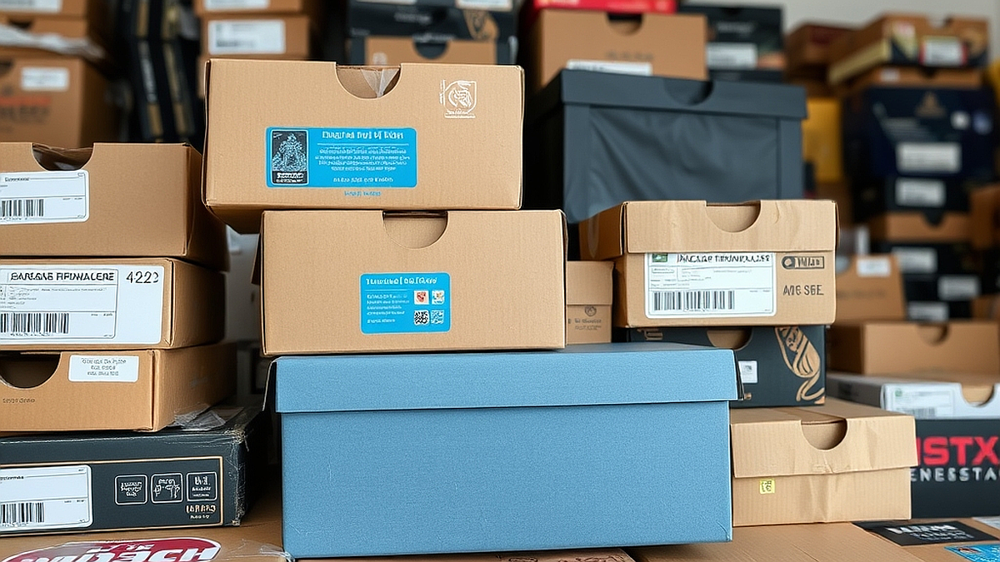

구독 경제의 함정, 취미 구독은 정말 이득일까라는 질문은 단순히 돈을 아끼자는 차원을 넘어, 내 일상의 시간과 공간을 누가 통제하고 있는지를 묻는 것과 같습니다. 매달 현관문 앞에 도착하는 예쁜 박스를 뜯으며 느끼는 설렘은 분명 강력한 도파민을 제공합니다. 하지만 그 박스가 두 개, 세 개 쌓여가며 방 한구석에서 먼지를 뒤집어쓰기 시작하면 상황은 달라집니다. 취미 구독 서비스는 본래 '시작의 문턱'을 낮추기 위해 고안되었습니다. 재료를 일일이 구하러 다니는 수고를 덜어주고, 전문가의 큐레이션을 통해 실패 확률을 줄여준다는 명분입니다.

하지만 실상은 어떨까요. 우리는 매달 정해진 비용을 지불하지만, 그 대가로 받는 것은 완성된 취미가 아니라 '언젠가 하겠지'라는 부채감입니다. 특히 좁은 원룸이나 수납공간이 부족한 환경에 사는 사람들에게 취미 박스는 해결책이 아니라 또 다른 짐이 됩니다. 이번 글에서는 왜 우리가 취미 구독 서비스 앞에서 경제성을 잃게 되는지, 그리고 나에게 맞는 지속 가능한 소비를 위해 어떤 기준을 세워야 하는지 실전적인 관점에서 파헤쳐 보려 합니다. 단순히 서비스를 해지하라는 권유가 아닙니다. 구독이라는 시스템이 내 취향과 어떻게 충돌하는지, 그리고 어떤 조건에서만 이 모델이 이득이 되는지를 따져보겠습니다.

## 첫 번째 함정: 재료의 과잉과 시간의 결핍

취미 구독 서비스의 가장 큰 모순은 '제공되는 재료의 양'과 '나의 가용 시간' 사이의 불균형입니다. 보통 서비스는 한 달에 한 번, 혹은 격주로 패키지를 보냅니다. 기획자 입장에서는 매번 새로운 경험을 제공해야 하므로 난이도나 종류를 다채롭게 구성합니다. 문제는 사용자가 매번 그 속도를 따라갈 수 없다는 점입니다. 예를 들어 자수나 가죽 공예 같은 핸드메이드 구독 서비스의 경우, 한 작품을 완성하는 데 최소 4시간에서 8시간이 필요합니다. 하지만 주말을 온전히 취미에 쏟을 수 있는 직장인은 많지 않습니다.

실제 사례를 들어보겠습니다. 매달 3만 원대의 DIY 키트를 구독하던 A씨는 초기 3개월간은 즐거움을 느꼈습니다. 하지만 4개월 차부터 업무가 바빠지며 키트가 미개봉 상태로 쌓이기 시작했습니다. 6개월이 지났을 때 A씨의 책상 위에는 뜯지도 않은 박스가 4개나 쌓여 있었고, 결국 그는 매달 3만 원씩 버리고 있다는 죄책감에 서비스를 해지했습니다. 이 경우 구독 경제는 취미의 성장을 돕는 도구가 아니라, 소비자의 나태함을 자극하는 징벌적 비용으로 변질됩니다.

실패하지 않기 위한 체크 포인트는 명확합니다. '내가 이 키트를 주말에 3시간 안에 끝낼 수 있는가?'를 자문해야 합니다. 만약 준비 과정부터 정리까지 5시간이 넘게 걸리는 작업이라면, 구독 서비스보다는 필요한 재료만 개별적으로 구매하는 것이 훨씬 경제적입니다. 구독은 반복적인 숙련을 돕는 도구여야지, 새로운 물건을 계속 공급받는 창고가 되어서는 안 됩니다.

## 두 번째 함정: 큐레이션이라는 이름의 강제성

구독 서비스의 핵심 가치는 '큐레이션'입니다. 내가 무엇을 좋아하는지 고민할 필요 없이, 전문가가 골라준 것을 따라가면 된다는 안도감을 줍니다. 하지만 취미의 본질은 '자발적인 선택'에 있습니다. 내가 직접 재료를 고르고, 어떤 색을 쓸지 고민하고, 실패했을 때 왜 실패했는지 찾아보는 과정 자체가 취미의 영역입니다. 구독 서비스는 이 과정을 생략합니다. 

실제 사례로 커피 원두 구독 서비스를 이용했던 B씨는 매달 다른 산지의 원두를 받아보는 재미를 느꼈습니다. 하지만 반년이 지나자 그는 본인이 진짜 좋아하는 맛의 취향을 잃어버렸음을 깨달았습니다. 서비스가 보내주는 대로 마시다 보니, 정작 자신이 산미가 강한 원두를 좋아하는지, 고소한 맛을 선호하는지 판단하는 능력이 무뎌진 것입니다. 

선택 기준은 다음과 같습니다. 해당 취미가 '입문 단계'인가, 아니면 '숙련 단계'인가를 구분해야 합니다. 입문 단계라면 큐레이션이 유용합니다. 무엇을 사야 할지 모르는 상태에서 전문가의 가이드는 시행착오를 줄여주니까요. 하지만 어느 정도 경험이 쌓였다면, 그때부터는 구독을 멈추고 직접 재료를 골라야 합니다. 직접 고르는 수고를 아까워하는 순간, 그 취미는 더 이상 발전하지 않고 정체됩니다. 만약 당신이 6개월 이상 같은 구독 서비스를 이용하고 있는데, 여전히 재료 이름조차 외우지 못하고 있다면 그 서비스는 당신의 취향을 가두고 있는 셈입니다.

## 실전 체크리스트: 구독을 유지할지 결정하는 3단계

구독 경제의 함정에서 벗어나기 위해 지금 당장 자신의 상태를 점검해 봅시다. 다음은 제가 실무적으로 제안하는 '취미 구독 점검표'입니다. 이 질문에 하나라도 '아니오'가 나온다면 지금 즉시 해지를 고려해야 합니다.

1. 지난달에 배송된 키트를 이번 달이 끝나기 전에 완전히 소비했는가? (완성품이 남았다면 해지 대상)
2. 키트의 재료를 개별적으로 구매할 때보다, 구독 가격이 20% 이상 저렴한가? (배송비와 편의성을 감안해도 개별 구매가 싼 경우가 많습니다)
3. 이 취미를 통해 얻는 즐거움이 '물건을 뜯는 재미'인가, '만드는 과정의 재미'인가? (물건을 뜯는 재미라면 그것은 취미가 아니라 쇼핑 중독입니다)

또한 실패를 줄이기 위한 마케팅적 관점의 팁을 드립니다. 구독 서비스는 '연속성'을 강조합니다. 3개월, 6개월 약정을 하면 할인해 준다는 유혹에 빠지지 마세요. 취미는 변덕스러운 것입니다. 계절이 바뀌면 하고 싶은 것도 달라집니다. 할인을 위해 6개월을 묶어두는 것은 내 취향의 유연성을 스스로 차단하는 행위입니다. 무조건 '단기 결제'로 시작하고, 3개월이 지나도 흥미가 유지될 때만 기간을 늘리십시오.

## 결론: 취미는 소유하는 것이 아니라 경험하는 것

취미 구독 서비스는 잘 활용하면 시간과 에너지를 아껴주는 훌륭한 도구이지만, 잘못 활용하면 짐만 늘리고 지갑을 갉아먹는 함정이 됩니다. 핵심은 구독 서비스가 내 일상을 주도하게 두지 않는 것입니다. 매달 오는 박스를 반기는 것이 아니라, 내가 그 박스를 통제하고 있는지 확인해야 합니다. 

만약 지금 집에 쌓여 있는 키트들이 당신을 압박하고 있다면, 망설이지 말고 구독을 해지하십시오. 그리고 그 돈으로 내가 진짜 만들고 싶었던 재료 딱 하나를 직접 사러 나가보세요. 도구점에서 재료를 고르고, 사용법을 익히고, 나만의 방식으로 완성하는 그 모든 과정이 진짜 취미입니다. 구독 경제의 편리함 뒤에 숨겨진 '취향의 외주화'를 멈추고, 다시 나의 주도권을 찾아올 때 비로소 취미는 온전한 휴식이 됩니다. 지금 바로 구독 관리 앱을 켜고, 지난 3개월간 사용하지 않은 서비스가 있는지 확인해 보시기 바랍니다. 당신의 취미는 누군가 배송해 주는 물건이 아니라, 당신이 직접 선택한 시간 속에 존재해야 합니다.

매달 찾아오는 취미 박스는 설렘을 주지만, 사용하지 못해 쌓여가는 순간 온전한 휴식이 아닌 스트레스와 낭비로 변질됩니다. 결국 취미의 본질은 남이 골라준 재료를 해치우듯 소비하는 것이 아니라, 내가 직접 탐색하고 몰입하는 과정 그 자체에 있습니다. 편리함에 가려져 있던 내 취향의 주도권을 되찾아올 때 비로소 취미는 진정한 활력소가 됩니다.

지금 잠시 스마트폰을 열어 결제 내역을 훑어보는 건 어떨까요? 지난 몇 달간 손도 대지 못한 채 공간과 마음만 차지하고 있던 취미 구독이 있다면 과감하게 '구독 해지' 버튼을 눌러보세요. 남은 키트는 주말에 가벼운 마음으로 하나씩 정리해 보셔도 좋습니다.

남겨진 시간과 절약한 비용으로 이번 주말엔 내가 정말 해보고 싶었던 작은 일 하나를 직접 시작해 보세요. 동네 문구점에 들러 마음에 드는 펜 한 자루를 고르는 것만으로도 충분합니다. 여러분이 주도하는 진짜 취미 생활을 응원합니다.
