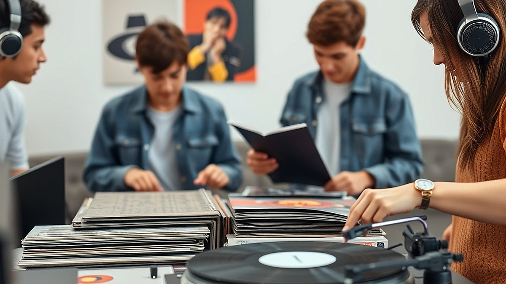

바이닐(LP) 열풍의 민낯은 생각보다 훨씬 더 선명하게 우리 일상 속으로 침투해 있습니다. 대형 서점의 음반 코너를 지나다 보면, 턴테이블이 없는 이들이 진지한 표정으로 앨범 재킷을 고르는 모습을 심심치 않게 발견합니다. 음악을 듣기 위한 매체로서의 기능보다, 좋아하는 아티스트의 예술적 결과물을 물리적인 형태의 굿즈로 소유하려는 욕구가 더 크게 작용하는 현상입니다. 스트리밍 서비스로 전 세계의 음원을 무제한 감상할 수 있는 시대에, 왜 사람들은 굳이 턴테이블도 없으면서 LP를 구매하는 걸까요? 

이 현상의 핵심은 음악 감상의 '효율성'이 아니라 '물리적 실체'에 대한 갈망입니다. 디지털 파일은 손에 잡히지 않기에 쉽게 소비되고 잊히지만, LP는 12인치라는 큼지막한 크기와 정성스러운 아트워크 덕분에 그 자체로 공간을 채우는 오브제가 됩니다. 하지만 단순히 예뻐서 샀다가 나중에 처치 곤란한 짐이 되어 당근마켓에 매물로 내놓는 경우도 허다합니다. 오늘 이 글에서는 턴테이블이 없는 당신이 LP를 구매하기 전 반드시 고려해야 할 현실적인 기준과, 이 취미를 어떻게 '인테리어'에서 '음악 감상'으로 확장할 수 있을지 그 실전적인 방법을 다뤄보겠습니다.

## 소장용 굿즈로서의 LP, 구매 전 반드시 따져볼 세 가지

LP를 처음 구매하려는 사람들이 가장 많이 하는 실수는 앨범의 디자인만 보고 덜컥 결판을 내는 것입니다. LP는 일반적인 책이나 포스터와 달리 보관 조건이 까다롭습니다. 

첫째, 보관 공간의 환경을 체크하세요. LP는 PVC 재질이라 열에 매우 취약합니다. 햇빛이 직접 들어오는 창가나 전열기구 근처에 두면 판이 휘어버립니다(워핑 현상). 만약 당신의 방이 좁아서 LP를 세워둘 공간이 마땅치 않다면, 구매를 다시 고려해야 합니다. LP는 반드시 수직으로 세워 보관해야 하며, 눕혀서 쌓아두면 무게 때문에 아래쪽 판이 변형됩니다.

둘째, '소장 가치'의 기준을 정하세요. 한정판 컬러 바이닐이나 스페셜 패키지는 분명 매력적이지만, 실제 음악을 듣지 않는다면 결국 먼지 쌓인 장식품이 될 뿐입니다. 내가 이 앨범을 5년 뒤에도 여전히 좋아할 것인지, 혹은 이 앨범의 아트워크가 내 방의 분위기와 조화를 이룰 수 있을지 고민해야 합니다. 

셋째, 실패 케이스를 피하는 법입니다. 가장 흔한 실패는 '아무 턴테이블이나 사서 돌리는 것'입니다. 10만 원 이하의 초저가형 올인원 턴테이블은 바늘 압력이 너무 세서 LP의 홈을 깎아먹는 경우가 많습니다. 만약 당신이 정말 음악을 감상하고 싶다면, 처음부터 턴테이블 예산을 30~50만 원 선으로 잡는 것이 장기적으로 LP를 보호하는 길입니다. 반대로 단순히 전시만 할 목적이라면 턴테이블은 아예 사지 않는 편이 경제적입니다. 인테리어용으로 쓴다면, 벽에 걸 수 있는 전용 프레임을 구매해 앨범을 액자처럼 활용하는 것이 훨씬 깔끔한 연출 방법입니다.

## 턴테이블 없는 당신을 위한 실전 체크리스트

턴테이블이 없어도 LP를 사는 것은 잘못된 일이 아닙니다. 다만, 그 목적을 명확히 하면 불필요한 지출을 줄일 수 있습니다. 아래 체크리스트를 통해 자신의 소비 패턴을 점검해 보세요.

실전 체크리스트:
1. 구매 목적: 음악 감상용인가, 전시용인가? (전시용이라면 LP 관리 도구보다 액자 구매가 우선입니다.)
2. 예산 범위: 앨범당 5~8만 원의 지출이 가능한가? (스트리밍보다 훨씬 비싼 매체임을 인지해야 합니다.)
3. 보관 환경: 직사광선을 피하고 LP를 세워서 꽂을 수 있는 15cm 이상의 공간이 확보되었는가?
4. 향후 계획: 1년 이내에 턴테이블을 구입할 의사가 있는가? (없다면 지금 사는 LP는 평생 '굿즈'로 남습니다.)

만약 위 항목 중 세 가지 이상이 '아니오'라면, LP보다는 해당 아티스트의 고화질 포스터나 한정판 굿즈를 찾는 것이 훨씬 합리적입니다. LP는 무게가 상당하고 배송 중 파손 위험도 큽니다. 특히 중고 거래를 할 때는 판의 상태를 직접 눈으로 확인해야 하는데, 초보자가 이를 판별하기란 매우 어렵습니다. 

실수하기 쉬운 부분은 '중고 음반 매장에서의 충동구매'입니다. 상태가 좋아 보여도 판 내부에 미세한 스크래치가 있으면 재생 시 '틱' 소리가 반복적으로 들립니다. 이를 해결하려면 고가의 세척 장비가 필요합니다. 처음 시작한다면 중고보다는 신품(새 제품)을 사서 관리법을 익히는 것이 정신 건강에 이롭습니다. 턴테이블이 없는 상태라면, 우선 가장 좋아하는 앨범 1장만 구매해 보십시오. 그것을 손에 쥐었을 때 느끼는 만족감이 디지털 음원보다 크다면, 그때 턴테이블 입문을 고민해도 늦지 않습니다.

## 아날로그 감성을 유지하며 음악을 즐기는 현실적 단계

LP를 소장하는 것은 단순히 물건을 사는 행위가 아니라, 음악을 대하는 태도를 바꾸는 과정입니다. 턴테이블이 없어도 LP를 사는 행위가 즐겁다면, 이제는 그 즐거움을 확장할 차례입니다.

첫 번째 단계는 '감상 환경 구축'입니다. 입문용 턴테이블을 구매할 때는 반드시 '포노 앰프'가 내장된 모델인지 확인하세요. 그렇지 않으면 별도의 앰프와 스피커를 연결해야 하는데, 여기서부터 비용이 기하급수적으로 늘어납니다. 공간이 좁다면 소형 액티브 스피커와 연결 가능한 턴테이블 모델을 선택하는 것이 가장 효율적입니다.

두 번째 단계는 '관리의 습관화'입니다. LP는 정전기에 약합니다. 턴테이블이 없어도 LP를 닦는 '카본 브러시'는 하나 장만해 두는 것이 좋습니다. 앨범을 꺼낼 때마다 겉면의 먼지를 털어주는 습관만으로도 앨범의 수명을 2배 이상 늘릴 수 있습니다. 

세 번째 단계는 '감상의 의식화'입니다. LP는 곡을 건너뛰기가 어렵습니다. 그래서 앨범 전체를 처음부터 끝까지 듣게 됩니다. 이런 '느린 감상'은 디지털 환경에서 결코 경험할 수 없는 가치입니다. 턴테이블이 준비되었다면, 일주일에 딱 한 번, 좋아하는 LP를 꺼내 정성스럽게 바늘을 올리는 시간을 가져보세요. 

결론적으로, LP는 더 이상 음악을 듣는 유일한 수단이 아닙니다. 그러나 당신의 취향을 물리적으로 증명하고, 음악을 듣는 행위를 특별한 이벤트로 만들어주는 가장 강력한 도구입니다. 턴테이블이 없다는 이유로 LP 구매를 주저할 필요는 없습니다. 다만, 그 앨범이 단순한 소품으로 남을지, 당신의 음악 세계를 넓혀줄 첫걸음이 될지는 오직 당신의 관리와 관심에 달려 있습니다. 오늘 당신의 방 한구석에 놓일 첫 번째 LP가 단순한 장식품 이상의 의미를 가지길 바랍니다. 지금 바로 당신이 가장 좋아하는 앨범의 재킷 디자인을 살펴보며, 그 음악이 당신의 공간과 어떤 대화를 나눌지 상상해 보시기 바랍니다.

## 마치며

LP 열풍의 본질은 단순히 ‘소리를 듣는 것’에 그치지 않습니다. 눈으로 아트워크를 감상하고, 손으로 음반을 만지며, 좋아하는 아티스트를 향한 마음과 내 취향을 일상 속에 실물로 소장하는 특별한 경험이죠. 턴테이블이 없어도 괜찮습니다. 방 한편을 묵묵히 채우는 바이닐 한 장만으로도 당신의 공간은 이미 좋아하는 음악의 온도로 물들기 시작하니까요.

이제 여러분의 차례입니다. 이번 주말에는 스마트폰 스트리밍 대신, 가까운 레코드 숍을 찾아가거나 온라인 샵을 둘러보는 건 어떨까요? 손끝에 닿는 커다란 앨범 커버를 고르며 잊고 지냈던 음악의 설렘을 직접 만져보세요. 

혹시 여러분의 마음을 사로잡은 ‘인생 첫 LP’가 있나요? 아니면 턴테이블 없이도 방 한편에 소중히 간직하고 있는 앨범이 있으신가요? 여러분만의 특별한 바이닐 이야기를 댓글로 편하게 들려주세요. 함께 음악 이야기를 나눠요!
